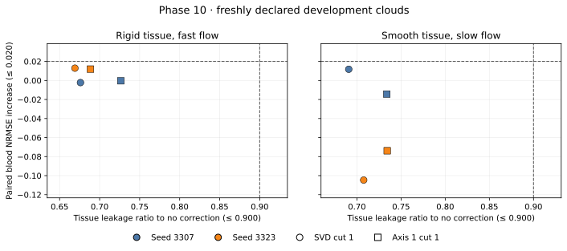

# Phase 10: core support and mode safeguard, development result

25 October 2026. The [candidate and split](ESDIVA_PHASE10_FROZEN_CANDIDATE.md)
were committed as `b38fb97` before generating RF for newly declared seeds
**3307 and 3323**. The [all-scene decision](../runs/esdiva_phase10_design/decision.json)
is **qualified to freeze prospective development 2333**, with eight complete
scenes and no failures. The [archived reports, RF replay audits, and scores](../runs/esdiva_phase10_design/fresh/)
and their [hash manifest](../runs/esdiva_phase10_design/manifest.json) retain
the input and numerical source identity. The large source RF checkpoints
remain local and are not in Git. The wider replay reproduced the scored core
IQ exactly in all scenes; tissue-plus-blood RF additivity errors were about
1.38–1.41×10⁻⁷.

The 5.5 mm core annotation remained source-pure: the maximum evaluator-only
core blood/tissue power was **0.00778** (limit 0.100). All eight phase-coherent
calibration gates passed. The lowest wide validation coherence was **0.82555**
(limit 0.700), and the lowest core validation coherence was **0.86563**
(limit 0.500 with the train-ratio check). The gate-only phase map never
replaced the original IQ passed to the filters.

| Cloud | Rigid SVD blood Δ / tissue ratio | Rigid Axis 1 blood Δ / tissue ratio | Slow SVD blood Δ / tissue ratio | Slow Axis 1 blood Δ / tissue ratio |
|:--|:--|:--|:--|:--|
| 3307 | −0.0022 / 0.6761 | −0.0003 / 0.7265 | +0.0118 / 0.6907 | −0.0143 / 0.7338 |
| 3323 | +0.0129 / 0.6691 | +0.0119 / 0.6885 | −0.1046 / 0.7077 | −0.0738 / 0.7343 |

These values compare the selected correction with a same-scene no-motion
control. Both SVD cut 1 and Axis 1: Motion-compensated virtual long ensemble
cut 1 require paired blood NRMSE increase ≤0.020 in **every** scene and tissue
leakage ratio ≤0.900 in rigid fast and smooth slow. The largest blood
increase across all eight scenes is **+0.01654**, for 3307 smooth zero SVD.
Its bound applies even though zero flow has no moving-tissue reduction
requirement. All eligible paired roundtrips pass 1e−10.

The uncorrected slow-flow Axis 2: Motion-demodulated multi-lag separation
rank 4/cap 0.4 control also passes: blood NRMSE **0.5716/0.5729** and
tissue leakage **0.1566/0.1564** for 3307/3323, against 0.700/0.180.
The archived baseline includes SVD, Baranger SSM, Stephen Lee AER, and
Axis 3: Local ultrasound STAP comparators. Both fresh clouds selected the
hybrid mode for all four scenes. The reference safeguard retained a needed
reference mode on now-seen 2309 rigid fast in the design screen, but this
fresh bank did not independently exercise reference mode.

## Decision and limits

The 32/32 retrospective pass was used to design the revised mask, selector,
and phase fraction. The two new scatterer clouds supply development
confirmation, with four correlated scenes per cloud and 16 scored frames
per scene. They do not establish physical phantom performance or broad
anatomical generality. The first-eight versus last-eight calibration check
also shares stationary tissue scatterers across halves.

The full new-bank pass allows a **separate hash-bound prospective freeze**
before seed **2333** is opened. Reserves **2401/2411** and physical phantom
data remain unopened. A 2333 failure must remain a failure and cannot be
repaired by retuning on that seed.
