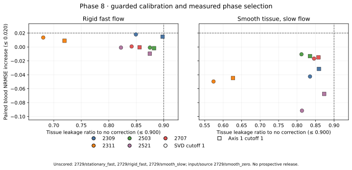

# Phase-8 guarded calibration: development result

25 October 2026. The [phase-8 split](../configs/esdiva_phase8_split.json),
[selector](../examples/esdiva_phase8_selector.py), [scorer](../examples/esdiva_phase8_score.py)
and [all-scene reviewer](../examples/esdiva_phase8_review.py) were frozen on
`main` before generating RF for seeds **2707 and 2729**. The
[fixed decision](../runs/esdiva_phase8_design/decision.json) is **incomplete
development comparison; no qualified candidate**. Seed 2707 passed its four
phase-8 scenes. Seed 2729 had three acquisitions stop at their unchanged core
training-ROI source-contamination limit and its remaining zero-flow scene
failed the new wide calibration/input gate. It cannot be relabeled a
confirmation pass.

The original phase-5 acquisition report's older angular gate also marked
2707 ineligible. Phase 8 deliberately uses the previously declared
wide-supported core rule and the new calibration guard, rather than treating
that older status as its gate. Its fixed source-resolved scorer accepted 2707
under the **phase-8** rule. This is a development comparison, not a
retrospective claim that the phase-5 acquisition gate passed.

## One complete new development cloud

On 2707, the train-only calibration choice was a 4 mm guard in all scenes.
All four phase-8 source/input checks passed. The independently simulated
tissue and blood RF had source-additivity error about 1.39–1.40×10⁻⁷ and
the wider IQ replay reproduced the central core exactly. The [archived
reports, replay audits and scores](../runs/esdiva_phase8_design/fresh/2707/)
retain method outputs and hashes. Values below compare the selected local
phase to the same-scene no-correction control; both blood NRMSE increments
must be ≤0.020, and both moving-tissue ratios must be ≤0.900.

| 2707 scene | SVD blood Δ | SVD tissue ratio | Axis 1 blood Δ | Axis 1 tissue ratio |
|:--|--:|--:|--:|--:|
| Stationary fast | −0.0000 | 1.0021 | −0.0000 | 1.0016 |
| Rigid fast | +0.0007 | 0.8416 | −0.0005 | 0.8561 |
| Smooth slow | −0.0166 | 0.8460 | −0.0149 | 0.8578 |
| Smooth zero | −0.0078 | 0.7963 | −0.0102 | 0.8216 |

The separate uncorrected slow-flow Axis 2: Motion-demodulated multi-lag
separation control had paired blood NRMSE **0.5763** (limit 0.700) and tissue
leakage **0.1611** (limit 0.180). Stationary leakage ratios above one are
reported; the preregistered 0.900 reduction bound applies to rigid fast and
smooth slow. The retrospective 2309/2311/2503/2521 results also pass this
new rule, but their cutoffs were chosen after those clouds were seen and
cannot serve as independent confirmation.

## Ineligible 2729 cloud

The unchanged acquisition source limit is blood-to-tissue power **≤0.100**
in the original core training ROI. Three 2729 acquisitions stopped before
writing an IQ source report. A separately labeled
[post-freeze RF diagnostic](../runs/esdiva_phase8_design/2729_postfreeze_diagnostic.json)
reconstructed these *already generated* RF checkpoints without changing the
candidate or scoring them:

| 2729 scene | Core training blood/tissue power | Acquisition report | Selected wide guard, validation coherence |
|:--|--:|:--|--:|
| Stationary fast | 0.10551 | Absent, source limit exceeded | 4 mm, 0.64892 |
| Rigid fast | 0.10302 | Absent, source limit exceeded | 4 mm, 0.65032 |
| Smooth slow | 0.10062 | Absent, source limit exceeded | 4 mm, 0.63618 |
| Smooth zero | 0.08335 | Present | 4 mm, 0.64495 |

All four diagnostic validation coherences are below the **unchanged 0.700**
wide-input threshold. In the completed zero-flow case, the scorer records
an input failure without filter scores; evaluator-only blood contamination
of its selected wide tissue ROI is **0.298**, above its 0.100 ceiling. The
[zero-flow source report, wider replay audit and rejected score](../runs/esdiva_phase8_design/fresh/2729/smooth_zero/)
are archived. The other three scenes remain explicitly **missing scores**,
not estimated passes or paired filter failures. The post-freeze diagnostic
uses isolated blood only to explain ineligibility; it was never a regular
input or selection signal.

## Decision and next experiment

The reviewer records three missing scenes and one input/source failure on
2729. Thus the candidate is **not qualified** to open prospective seed
**2333** or fresh reserve **2401/2411**. No physical phantom was acquired;
the [phase-5-to-phantom bridge](PHANTOM_PHASE5_BRIDGE.md) stays conditional.
The positive 2707 result supports the guarded local-phase mechanism on one
new scatterer cloud but does not establish cloud robustness.

Next, repair the **source-independent calibration support and tissue mask
eligibility** across scatterer clouds. Examine which prior-calibration or
structural measurements can predict a sufficiently coherent,
low-blood tissue region, and address the original core ROI source limit in
the acquisition protocol before declaring another bank. Keep isolated
source power as an evaluation check, not an input. Develop on now-seen
clouds including 2729, freeze a revised numerical candidate and source
contract, then test on new declared development seeds. A full all-scene
pass would allow a separate prospective freeze for 2333; a later 2333
pass would be required before opening the reserve or acquiring phantom data.
