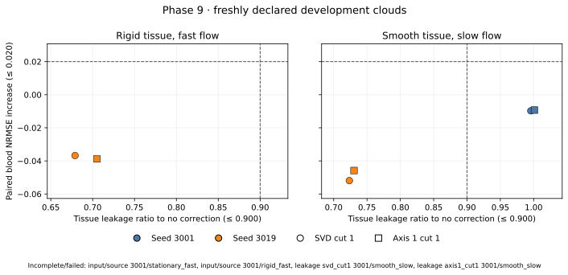

# Phase 9: source-independent support repair, development result

25 October 2026. The [phase-9 source contract and candidate](ESDIVA_PHASE9_FROZEN_CANDIDATE.md)
were committed as `0fa7648` before generating RF for newly declared seeds
**3001 and 3019**. GitHub Actions passed on that freeze. The [all-scene
decision](../runs/esdiva_phase9_design/decision.json) is **no qualified
candidate; prospective and reserve unopened**. There are no missing scenes.
The [archived acquisition reports, wider RF replay audits and scores](../runs/esdiva_phase9_design/fresh/)
and their [manifest](../runs/esdiva_phase9_design/manifest.json) preserve
source and numerical identity. The original large RF checkpoints are not
committed. Each scene's wider replay reproduced its central IQ exactly,
and independent tissue/blood RF source additivity errors were about
1.38–1.45×10⁻⁷.

The fixed 5 mm anatomical tissue guard and first-eight-frame spatial angular
phase-map gate passed their source-independent calibration checks on **all
eight** fresh scenes. In particular, the minimum wide validation coherence
was 0.8610 on 3001 and 0.8828 on 3019, against 0.700. This phase map is
only an eligibility diagnostic; the filters saw the original unmodified IQ.
The validation half shares stationary scatterer anatomy with the fit half,
so this is temporal consistency, not independent tissue anatomy validation.

## Source purity and paired motion

The evaluator-only core tissue power ratio has a frozen ceiling of **0.100**.
Seed 3001 fast flow exceeds it in two scenes. Their score records contain
input diagnostics and **no filter outputs**. The 32-row guard remains well
below its own ceiling; the failure is concentrated in the central eight-row
scoring annotation. No post-hoc mask change or threshold relaxation was made.

| New cloud | Scene | Core blood/tissue | Input outcome | Selected mode |
|:--|:--|--:|:--|:--|
| 3001 | Stationary fast | 0.11392 | Source fail; unscored | — |
| 3001 | Rigid fast | 0.11259 | Source fail; unscored | — |
| 3001 | Smooth slow | 0.09205 | Eligible | Reference |
| 3001 | Smooth zero | 0.09040 | Eligible | Reference |
| 3019 | Stationary fast | 0.00981 | Eligible | Hybrid |
| 3019 | Rigid fast | 0.00840 | Eligible | Hybrid |
| 3019 | Smooth slow | 0.01242 | Eligible | Hybrid |
| 3019 | Smooth zero | 0.01332 | Eligible | Hybrid |

The paired blood NRMSE increase limit is **≤0.020** for both SVD cut 1 and
Axis 1: Motion-compensated virtual long ensemble cut 1 in every eligible
scene. The moving-tissue leakage ratio limit is **≤0.900** in rigid fast and
smooth slow. The table shows the eligible moving scenes; all their paired
blood increments pass, but 3001 smooth slow does **not** suppress tissue.

| Cloud, moving scene | SVD blood Δ | SVD tissue ratio | Axis 1 blood Δ | Axis 1 tissue ratio |
|:--|--:|--:|--:|--:|
| 3001 smooth slow | −0.0097 | **0.9957 fail** | −0.0093 | **1.0012 fail** |
| 3019 rigid fast | −0.0368 | 0.6790 | −0.0388 | 0.7051 |
| 3019 smooth slow | −0.0519 | 0.7235 | −0.0458 | 0.7305 |

The source-pure 3019 cloud passes all four scenes. Its separate uncorrected
slow-flow Axis 2: Motion-demodulated multi-lag separation rank 4/cap 0.4
control has blood NRMSE **0.5405** (limit 0.700) and tissue leakage **0.1594**
(limit 0.180). For 3001 smooth slow these are 0.6056 and 0.1669, also
passing. All eligible paired roundtrips meet the 1e−10 gate. The scored
control set includes SVD, Baranger SSM, Stephen Lee AER, and Axis 3: Local
ultrasound STAP, but the decision here is the frozen paired motion rule.

## Decision and next experiment

The six now-seen clouds passed the revised [retrospective screen](../runs/esdiva_phase9_design/retrospective.json),
but that screen was used to select the guard and phase parameters. The new
bank shows why it cannot be treated as independent confirmation: source
contamination in the eight-row core varies sharply by scatterer cloud, and
the mixture-only selector chose reference transport on 3001 smooth slow
without a paired tissue benefit. The successful 3019 hybrid result does not
erase the 3001 failures.

Seed **2333** and reserves **2401/2411** remain unopened. The [phantom
geometry bridge](PHANTOM_PHASE5_BRIDGE.md) remains conditional; no physical
phantom data were acquired. Next, develop a core support rule that uses
available calibration or pre-score mixture measurements to identify reliable
tissue across clouds without isolated source truth. Independently repair the
reference-mode decision against a measurable tissue-consistency surrogate
on new development clouds. Freeze both changes with fresh seeds before
opening 2333. Keep source-resolved purity and paired blood response as
evaluator-only tests throughout.
