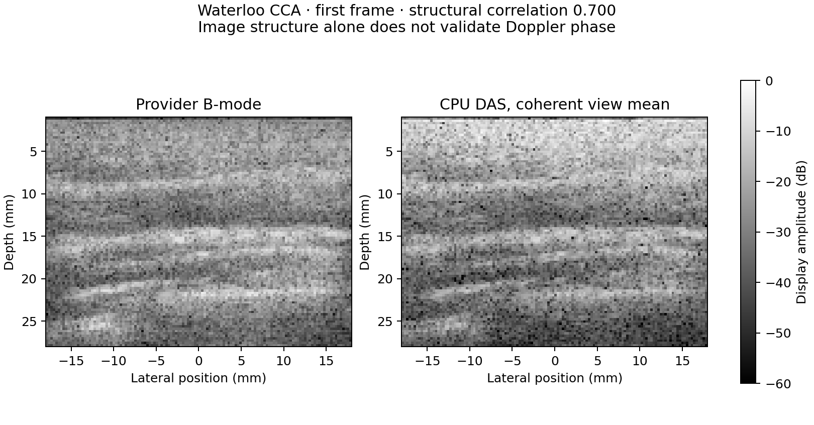

# First bounded Open H-RF processing pilot

Historical v0.2.0 pilot. The [follow-up protocol](FOLLOWUP_PROTOCOL_V04.md)
fixes two subjects and longer disjoint calibration/evaluation segments.

This is an engineering check on experimental channel data. It has no independent
blood/tissue source truth, no experimental oracle, and no separation-accuracy or
physiological conclusion. The target is a traceable unfiltered complex-IQ path
that can later support tissue-rejection and blood-preservation validation.

## Acquisition and reconstruction

- Source: Waterloo/LITMUS CCA baseline `waterloo-carotid/data/Acq0.hdf5`.
- Hugging Face revision: `05234aa084b27c8e4d0096c3a9adc33fbbc123d8`.
- Full acquisition: 30,000 frames, two transmit angles, 128 channels.
- Read window: frames 0:64, 128 MiB of decoded real RF. The complete large file
  was not downloaded. HTTP range reads and bounded block caching were used.
- Frequencies: 5 MHz center, 32.5 MHz sample, 3 kHz same-view revisit.
- Views: -10/+10 degrees, normal receive DAS, offsets 0 and 166.667 microseconds.
- Grid: 96 by 128; no clutter filter, envelope detection or frame normalization
  before export. Hardware gain is retained.

The [geometry contract](../configs/openhrf_waterloo_acq0_geometry.json) records the
time-origin and aperture evidence. For element position \(r_e\) and transmit
direction \(n_a\), the stored delays obey

\[
d_{ae}=t_a^{\rm ref}+r_e\cdot n_a/c.
\]

The fitted reference is 2.1824193 microseconds for both views; maximum residual
is 7.76e-6 ADC samples. This checks the encoded plane-wave geometry. Quantitative
experimental phase/gain calibration remains necessary. The file identifies US4R;
the provider separately warns about receive multiplexing in US4R-lite files.

The adapter embeds `iq_views`, angles and offsets with
`iq = iq_views.mean(axis=1)`. A numerical moving-point test traverses RF export,
NPZ reload and the standard STAP runner, checking the expected IQ phase sign and
velocity scale. Stored event intervals determine timing; declared PRF mismatches
and gapped view schedules are rejected.

## Calibration/evaluation protocol

Frames 0:32 estimate bulk tissue velocity. Frames 32:64 are the disjoint evaluation
packet, lasting approximately 10.67 ms; its absolute slow-time origin is retained.
The benchmark samples every second exported spatial grid point (48 by 64).

The brightest calibration-power quartile defines an automatic nuisance ROI.
Its tissue-only status is unverified. The estimated bulk vector is approximately
(-0.051, -0.486) mm/s in (z,x). It is a nuisance estimate, not physical truth.

The pilot includes 52 standard data-only settings, the unfiltered control,
three view-SVD arms and two STAP arms: 58 outputs. Joint view-SVD uses the same
views as STAP. Its matched-window version uses the same four-frame window/two-frame
hop; its calibrated version receives the same velocity estimate as STAP. The
calibration and test packets come from one acquisition and are correlated;
they are not independent subjects or separately acquired calibration scans.

Component metrics remain unavailable. ROI output power is a nuisance-region
proxy. Better-looking PD, reduced power or agreement with the provider's
wall-filtered velocity maps would not establish preservation of blood information.

## Provider structure check



The provider B-mode is interpolated to the exported grid. Spatial correlation
of log-amplitudes is **0.700319**. The provider uses different receive steering
and apodization. The comparison supports recognizable spatial structure;
it does not validate Doppler phase, velocity or exact beamformer parity.

## Reproduction

```bash
python examples/beamform_openhrf_window.py \
  https://huggingface.co/datasets/nvidia/Open-H-RF/resolve/05234aa084b27c8e4d0096c3a9adc33fbbc123d8/waterloo-carotid/data/Acq0.hdf5 \
  configs/openhrf_waterloo_acq0_geometry.json data/waterloo_acq0_64.npz
python examples/run_openhrf_pilot.py data/waterloo_acq0_64.npz runs/my_openhrf_pilot
python examples/compare_openhrf_bmode.py data/waterloo_acq0_64.npz runs/my_provider_check
```

IQ/NPZ arrays stay outside Git. The repository contains configurations,
[method records](../runs/openhrf_waterloo_pilot_v03/SUMMARY.md), hashes and the
[pilot manifest](../runs/openhrf_waterloo_pilot_v03/pilot_manifest.json).

Attribution: Hassan Nahas, Jason Y.-H. Hsu, Theresa Gu, Adrian J. Y. Chee and
Alfred C. H. Yu, LITMUS, University of Waterloo, via Open H-RF (CC BY 4.0).
The reconstruction and comparison figure are derived processing by this project.
Native-blood/no-injection status remains inferred from the provider description.
