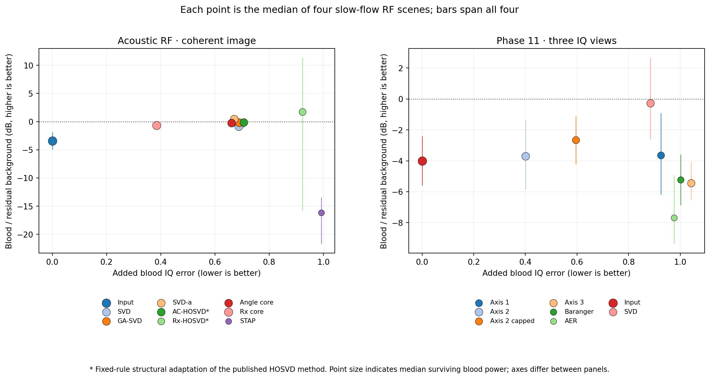

# Flow signal versus remaining background: retrospective contrast audit

26 October 2026. The [row-level archive](../runs/flow_background_audit_v1/rows.csv.xz)
contains 24,165 case/method/definition rows from the project's archived
benchmarks. It preserves development, evaluation, motion, phase-error and
method identities. Historical reruns and parameter sweeps are included for
coverage; they are **not** independent replications. The
[summary and source hashes](../runs/flow_background_audit_v1/summary.json),
[audit code](../scripts/flow_background_audit.py),
[RF replay](../scripts/recompute_multidim_contrast.py), and
[phase-10/11 paired replay](../scripts/recompute_esdiva_paired_contrast.py)
make the calculation inspectable. No previous frozen score or filter source
was edited.

## Definition and what can be calculated

For the same pixels, frames, and IQ representation, define

\[
 C_{B/BG}=10\log_{10}\frac{\sum|B_{\rm out}|^2}
                              {\sum|(T+N)_{\rm out}|^2}\quad\text{dB}.
\]

Positive values mean more **surviving blood power** than residual tissue plus
noise power in the scored area. They do not establish accurate blood IQ phase,
velocity, or visibility at every vessel pixel. In particular, an IQ error of
one could describe zero surviving blood *or* a blood signal of twice the true
amplitude: error alone cannot give this ratio.

For a mixture-fitted **frozen linear operator** \(F_X\), the numerator is
\(\|F_X(B)\|^2\) and the denominator is \(\|F_X(T+N)\|^2\). For filters that
refit to each input, the directly observable source counterfactual is instead
\(\|F(T+N+B)-F(T+N)\|^2/\|F(T+N)\|^2\). The latter measures an *incremental
blood response*: changes to an adaptive fit are included. It is not a unique
decomposition of the actual filtered mixture into physiological components.
The separate 0.1-amplitude injection results are also archived and labeled.

Where an archive stores surviving blood power \(q_B=\|B_{out}\|^2/\|B\|^2\),
background power remaining \(r_{BG}=\|BG_{out}\|^2/\|T\|^2\), and input
\(\rho=\|B\|^2/\|T\|^2\), the result is
\(C_{B/BG}=10\log_{10}(q_B\rho/r_{BG})\). We regenerated the v05/v06
source scenes and verified their *blood and tissue array hashes* before
recovering \(\rho\). The RF replay verified the old error, residual-background
score, and source-channel hashes method by method. The phase-10/11 replay
verified the archived paired errors and background powers.

The [CSV](../runs/flow_background_audit_v1/rows.csv.xz) labels rows as follows:

| Label | Meaning |
|:--|:--|
| `exact_frozen` | Blood and combined tissue-plus-noise were passed through one unchanged mixture-fitted operator. |
| `exact_paired_alpha1` / `exact_paired_alpha0.1` | Incremental blood response and separately refitted background, at the indicated injected strength. |
| `exact_oracle` | Exact powers but tissue truth or truth-selected rank/gain used: evaluation-only diagnostic. |
| `frozen_incoherent_proxy` | Earlier archive saved separate tissue and noise powers, but not their complex cross term. The point estimate sums their powers; rigorous minimum/maximum dB values are also given. |
| `frozen_tissue_only` | Earlier archive lacks filtered noise power; the point value excludes noise and must not be read as full background. |
| `bounded_*` | Only blood IQ error and background power were saved. The CSV gives rigorous bounds using \(|1-\epsilon_B|^2\le\|B_{out}\|^2/\|B\|^2\le(1+\epsilon_B)^2\), when input blood/tissue power is available. There is no exact point ratio. |

Unavailable values remain empty. In particular, some older phase-10 reserved
scores have no archived score-region input blood/tissue power or local source
checkpoint; assigning them a numeric dB ratio would substitute a training ROI
statistic from a different spatial region. Legacy statistical-IQ cohorts are
kept distinct from acoustic RF and measured phantoms. The legacy frozen rows
also record whether their component powers were evaluated on uncompounded
views or on compounded IQ; those domains must not be numerically pooled.

## Matched acoustic RF comparison: four slow-flow scenes

All methods below use the **same 240 transmissions over 80 ms**, the same
source-separated eSDIva RF, and the same final 16 compounded frames. Numbers
are medians of the *four per-case dB ratios*, rather than a dB conversion of
median powers. The two scatterer seeds were previously seen during phase 11;
this is a retrospective analysis. Lower IQ error and higher surviving blood
power are better; lower residual background is better.

| Method | Blood/background dB ↑ | Added blood IQ error ↓ | Blood power kept | Background power remaining |
|:--|--:|--:|--:|--:|
| Unfiltered | −3.40 | 0 | 1.000 | 1.016 |
| Compounded SVD | −0.86 | 0.688 | 0.460 | 0.271 |
| Jiang grouped-angle SVD | −0.20 | 0.690 | 0.473 | 0.241 |
| Ozgun receive-stacked SVD-a | **+0.47** | 0.671 | 0.510 | 0.226 |
| Jiang angular HOSVD adaptation | −0.12 | 0.706 | 0.429 | 0.222 |
| Ozgun receive HOSVD adaptation | +1.72 | 0.923 | 0.132 | 0.012 |
| Angle core intersection | −0.21 | 0.661 | 0.471 | 0.237 |
| Receive core intersection | −0.63 | **0.384** | **0.800** | 0.418 |
| Calibrated orthogonal STAP | −16.15 | 0.992 | 0.001 | 0.028 |

The apparent +1.72 dB of the *Ozgun-structured adaptation* is especially
fragile: the four case ratios span **−15.85 to +11.32 dB**, and its blood IQ
error is 0.923. The fixed-rule small-tile classifier is not a faithful test
of the authors' full acquisition and tuned temporal classifier. The receive
core retains 80% of blood power, but the high background leaves the global
ratio below zero. No tested source-blind method attains the previously declared
joint target of blood IQ error ≤0.25 and remaining background ≤0.10 here.

The global ratio can be misleading for a *velocity profile*. In an
evaluator-only local check, we formed per-pixel ratios and summarized pixels
whose unfiltered **true blood** power exceeded 10% of its maximum. Median
local dB was **+18.67 unfiltered**, **+14.40 for SVD**, and **+14.45 for the
receive-core rule**. Their corresponding tenth-percentile local values were
+4.89, +4.76, and +5.96 dB. Thus suppressing abundant tissue *outside* the
flow-rich pixels improved the global ratio while it could lower the local
ratio inside them. This exploratory true-blood-defined mask is unavailable
to a real filter, varies from 11 to 37 pixels between these cases, and omits
the weakest near-wall blood; it cannot certify a recoverable wall profile.

## Phase-11 filter comparison on the same slow RF cases

Here the original phase-11 **three-view IQ** representation and paired
background refits are retained. This is a different score domain from the
single compounded image above, so the two tables' absolute dB values should
not be merged. All four slow cases below use the `none` registration branch;
all other branches and cases are in the CSV.

| Phase-11 method | Blood/background dB ↑ | Added blood IQ error ↓ | Incremental blood power | Background power remaining |
|:--|--:|--:|--:|--:|
| Unfiltered round trip | −4.00 | 0 | 1.000 | 1.038 |
| SVD, discard 1 | **−0.27** | 0.885 | 0.350 | 0.143 |
| Axis 1 | −3.64 | 0.925 | 0.137 | 0.128 |
| Axis 2, default | −3.69 | **0.401** | 0.439 | 0.397 |
| Axis 2, capped | −2.66 | 0.596 | 0.204 | 0.158 |
| Axis 3 | −5.43 | 1.042 | 0.300 | 0.328 |
| Baranger selector | −5.22 | 1.001 | 0.031 | 0.029 |
| AER | −7.69 | 0.977 | 0.007 | 0.014 |

The highest ratio in this phase-11 comparison comes from SVD, but it also
has substantial blood IQ distortion. Axis 2 gives much better IQ fidelity
than SVD while its extra residual background cancels the power advantage.
Baranger and AER suppress the background strongly but leave little *paired
incremental* blood power in these acoustic slow-flow cases.

Older statistical-IQ experiments show why one cannot choose by dB alone:
in the v04 slow-overlap evaluation, long SVD reached **+16.86 dB** with blood
IQ error 0.327 and 89.3% retained power, while a short Baranger window
reached **+17.71 dB** with error 0.911 and only 18.5% retained power. In the
v06 smooth-deformation evaluation, Baranger reached **+10.01 dB** while
retaining only 5.3% of incremental blood power (error 0.993). These are
different synthetic scenes and must not be ranked against the acoustic RF
table; they demonstrate that a high power ratio can accompany blood loss.

## Measured Resolve Stroke: anatomical contrast, not blood SBR

The [measured tube-contrast CSV](../runs/flow_background_audit_v1/physical_tube_proxy.csv)
re-expresses the previously archived mean tube/background *image power* on
the microbubble bolus clip. It is **not** a blood-versus-residual-clutter
decomposition because separated blood and tissue IQ are unavailable.

| Filter, bolus window | 4 mm tube vs outside | 2 mm tube vs outside |
|:--|--:|--:|
| Raw | +2.54 dB | −2.87 dB |
| Compounded SVD | +9.16 dB | +12.81 dB |
| Receive-stacked SVD-a | +9.20 dB | +12.82 dB |
| Receive HOSVD adaptation | +9.58 dB | +13.61 dB |
| Receive core intersection | +2.44 dB | −2.69 dB |

These positive SVD tube contrasts agree with the earlier strong bolus AUC,
but the 2 mm tube uses only five pixels in this cropped pilot. The pre-bolus
raw 4 mm tube was already bright, and this is CEUS, not native slow red-cell
flow. A positive physical tube contrast does not validate preservation of a
noncontrast velocity profile.

## Interpretation for the next decision

The new ratio is a useful **third axis** alongside blood IQ error and
remaining background, but it is not a substitute for either one. In the
acoustic slow-flow cases, transmit-angle retention and receive SVD-a produced
only modest global improvements over ordinary SVD, while the simplest
receive-core filter preserved blood at the cost of background. The attractive
global ratios of very aggressive filters can result from discarding most blood.

To judge whether a *velocity profile* survives, score local signal/background
along the full lumen including the weak near-wall region, and measure
phase/Doppler velocity error and spatial coverage against independent truth.
The currently available Resolve Stroke microbubble window can test
anatomical localization, not those source-resolved native-blood endpoints.
