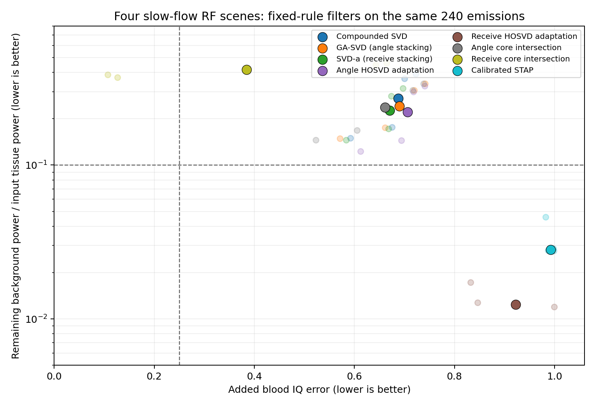

# Angular and receive-aperture information test (26 October 2026)

## Answer

On these acoustic RF scenes, **receive-aperture measurements contain some
additional information about slow blood**, but no tested source-blind
filter converts that information into the desired combination of slow-flow
preservation and tissue suppression. Preserving the three transmit angles
alone did not improve the source-aware slow-flow tradeoff over compounding on
these cases. The Resolve Stroke receive-channel pilot independently checks
that the aperture processing applies to measured IQ, but its microbubble
bolus cannot score isolated noncontrast blood IQ.

This is a bounded diagnostic, **not** a general information-theoretic limit,
an exact reproduction of either published HOSVD classifier, a new independent
RF holdout, or a physical claim about slow red-cell flow.

## Sources, acquisitions, and common score

The [eSDIva phase-11 source-separated RF bank](ESDIVA_PHASE11_PROSPECTIVE_FREEZE.md)
has already been seen in the earlier Axis-1/2 research. We used all five
predeclared scenes on each of its two scatterer clouds (3907 as development,
3919 evaluated once for **this** new method, although previously seen for the
phase-11 project). Its transmit sequence repeats **0°, −5°, +5°** for 80
evaluation cycles at 1 kHz per angle: 240 emissions over 80 ms. We use each
same RF event and the same final 16 cycles for every main method. The
compounded single-image control uses **all 240 emissions**; it is not a new
240-emission, single-angle acquisition. There is no five-angle acquisition
in this source bank. The STAP arm additionally uses the 16 earlier calibration
cycles and is labeled accordingly.

Raw eSDIva RF comprises 64 actual simulated receive channels per event. The
[delayer](../src/btbench/esdiva_aperture.py) reproduces the upstream plane-wave
TX delay, F/1 receive aperture, Hann taper, linear RF interpolation and common
RF-to-IQ carrier. Eight groups of eight delayed channels sum to the
already archived beamformed IQ. Across all cases, channel-sum replay errors
are below 0.02 for tissue, blood, and noise (normally much smaller). This is
source-resolved **acoustic simulation**, rather than statistically invented
receive views or a physical probe recording.

After freezing an operator on the observed mixture, the evaluator applies it
unchanged to isolated blood and to tissue plus noise. We report, on a common
coherently compounded image:

- **Added blood IQ error**: distance from the filtered isolated blood to the
  true blood IQ, divided by the true blood IQ magnitude. Zero preserves blood;
  one can mean essentially all of it was removed.
- **Remaining background power**: output tissue-plus-noise power divided by
  input true-tissue power. The research target is at most **0.10**, alongside
  blood IQ error at most **0.25**. These are declared research targets, not
  clinical acceptance limits.

The [configuration](../configs/multidim_aperture_v1.json),
[runner](../examples/multidim_aperture_study.py),
[frozen development/evaluation archive](../runs/multidim_aperture_v1/)
and [verifier](../scripts/verify_multidim_aperture.py) capture the identities
and all twenty scored scene/phase-condition records. A seen seed-3907 pilot
used only tissue ranks 1 and 2; the rank sweep 1, 2, 4, 8, 16 and source
hashes were frozen **before** scoring seed 3919 with these methods. The
phase-error arm adds ±0.12 rad of transmit-view drift and a fixed ±0.12 rad
receive-group phase offset to all sources. Real imposed rigid and smooth
tissue motions already occur in the acoustic RF bank.

## Precisely what was implemented

Let \(p\) denote pixel, \(t\) cycle, \(a\) transmit angle, and \(r\) delayed
receive group. \(X(p,t,a,r)\) is the common source for every main comparison.

| Name in archive | Filter input and rule | Source truth / calibration during filtering? |
|:--|:--|:--|
| Compounded SVD | First coherently average the three angles and sum receive groups; remove one leading temporal singular mode of \(X_{p,t}\). | No / no. |
| Jiang GA-SVD structure | Sum receive groups; SVD of \(X_{(p,a),t}\); remove one leading temporal mode, then compound. | No / no. |
| Ozgun SVD-a structure | Compound transmit angles; SVD of \(X_{(p,r),t}\); remove one leading temporal mode, then sum receive groups. | No / no. |
| Jiang-structured AC-HOSVD **adaptation** | HOSVD of \(X_{t,p,a}\); remove leading temporal factor and keep angular factors through a singular-value knee. The published spatial Pearson-correlation classifier and full published cutoff selection are **not** reproduced. | No / no. |
| Ozgun-structured HOSVD **adaptation** | HOSVD of \(X_{t,p,r}\); remove leading temporal factor, use the paper's 5-point-smoothed Nakagami spatial-noise criterion and a fixed Monte-Carlo random-phase aperture cutoff. We omit the upper temporal noise cutoff and substitute fixed rank one for the paper's tuned lower Doppler-frequency cutoff. | No / no. |
| Angle/receive core intersection | HOSVD on the indicated \(X_{t,p,a}\) or \(X_{t,p,r}\), but subtract **only** the intersection of its first temporal and first angle/aperture core factors. This is our exploratory rule, deliberately distinct from the published rectangular cutoffs. | No / no. |
| Orthogonal STAP | Existing 8-cycle local angle–time steering null, using a tissue-velocity estimate from the separate 16-cycle calibration packet. | No source truth / **yes**, plus known acquisition geometry. |
| Evaluation-only oracle | For each of compounded \(X_{p,t}\), angle–time \(X_{p,(t,a)}\), aperture–time \(X_{p,(t,r)}\), and full \(X_{p,(t,a,r)}\), fit the first 1, 2, 4, 8 or 16 right singular vectors **from isolated true tissue**. Within each fixed projector's subtraction-strength ray, find the smallest strength attaining 0.10 background power and report its blood error. | **Yes**; this is not deployable. |

The exact tensor decomposition and frozen reconstruction are in
[multidim.py](../src/btbench/multidim.py). Ozgun and Byram used delayed
receive-channel data and spatial, time, aperture HOSVD
([paper](https://doi.org/10.1109/TUFFC.2021.3073292)); Jiang *et al.* used
grouped-angle SVD and angular-coherence HOSVD
([paper](https://doi.org/10.1088/1361-6560/ad11a2)). In particular, we do
**not** describe this small-patch, fixed-rank protocol as replicating their
reported phantom or in-vivo performance. Ozgun's published temporal cutoff
was itself tuned, while the full Jiang spatial/threshold rule was not
implemented here. A faithful paper-to-paper reproduction would require those
settings, processing support and acquisition conditions.

## Source-separated RF results

The four **slow-flow** cases are rigid/smooth motion on each of two clouds;
the stationary-fast, rigid-fast and smooth-zero cases are retained in the
archive. Medians below are across the four slow-flow scenes in the clean-phase
arm. Smaller is better in both columns. No source-blind arm meets both limits
in any of the four slow cases.

| Method | Blood IQ error ↓ | Background power remaining ↓ |
|:--|--:|--:|
| Compounded SVD, rank 1 | 0.688 | 0.271 |
| Jiang GA-SVD structural arm | 0.690 | 0.241 |
| Ozgun SVD-a structural arm | 0.671 | 0.226 |
| Jiang-structured HOSVD adaptation | 0.706 | 0.222 |
| Ozgun-structured HOSVD adaptation | 0.923 | 0.012 |
| New angle core intersection | 0.661 | 0.237 |
| New receive core intersection | 0.384 | 0.418 |
| Calibrated orthogonal STAP | 0.992 | 0.028 |

The Ozgun-structured *adapted cutoff* rejected almost all blood on this
small 8×16 tile: its spatial noise classifier frequently retained only one
spatial mode. This is a specific failure of this **adaptation and support**,
not evidence that the published approach fails on its intended data. The
new receive intersection preserves more slow blood but leaves too much
background. The tested ±0.12 rad phase perturbations change these medians
little; this narrow perturbation does not establish robustness to real
aberration or tracking failures.

The source-aware oracle gives a more focused answer about extra information.
Each row below lists the **best** blood error among the predeclared ranks
that attain the 0.10 tissue limit. This is a per-case truth-guided envelope,
not a rank selector available to an operator.

| Cloud / slow scene | Compounded time | Angle–time | Receive–time | Angle–receive–time |
|:--|--:|--:|--:|--:|
| 3907 rigid | 0.353 | 0.364 | 0.349 | 0.284 |
| 3907 smooth | 0.340 | 0.409 | 0.306 | 0.255 |
| 3919 rigid | 0.281 | 0.309 | **0.241** | 0.303 |
| 3919 smooth | 0.313 | 0.346 | 0.273 | 0.335 |

Receive aperture improves the truth-guided error in all four slow scenes,
but only the 3919 rigid case crosses the ambitious 0.25 threshold. The
angle-only oracle is worse than compounding in all four; the combined
angle/aperture result varies across clouds. This supports a **limited**
aperture-information hypothesis without a robust practical filter.

## Measured Resolve Stroke receive pilot

The [measured-channel pilot](../scripts/resolvestroke_aperture_pilot.py)
uses the CC BY 4.0 [Open-H-RF Resolve Stroke phantom](https://github.com/open-h/Open-H-RF/blob/main/datasets/resolvestroke/phantom_flow/README.md).
There is one diverging-wave transmit per frame and 256 virtual receive
elements. We undo the documented hardware TGC, apply Zea 0.1.6's **actual
delay, receive mask, and IQ carrier phase rotation**, then form eight receive
groups from spatially sorted elements. Both fixed 128-frame windows use an
anatomical 10×39 subset of the x≈−5 mm plane with 17 pixels in the 4 mm
tube and five in the 2 mm tube. Eight groups reproduce the normal Zea DAS
image to relative error below **1.7×10⁻⁷**.

Tube-vs-depth-matched-background AUC from the
[measured result archive](../runs/resolvestroke_aperture_pilot_v1/report.json):

| Clip and method | 4 mm tube | 2 mm tube |
|:--|--:|--:|
| Pre-bolus, raw | 0.802 | 0.414 |
| Pre-bolus, compounded SVD | 0.318 | 0.289 |
| Bolus, raw | 0.811 | 0.501 |
| Bolus, compounded SVD | **0.986** | **1.000** |
| Bolus, receive-stacked SVD-a | **0.986** | **1.000** |
| Bolus, receive HOSVD adaptation | 0.980 | **1.000** |
| Bolus, new receive core intersection | 0.800 | 0.511 |

Thus the new intersection rule did not reproduce the strong tube
localization of SVD in this bolus window. The raw pre-bolus 4 mm AUC is
already 0.802, so that clip must not be called a flow-off or tissue-only
truth capture. The 2 mm mask has only five pixels here. AUC measures
anatomical localization of **microbubble** echoes, not preservation of
noncontrast slow blood or pixelwise blood IQ, and these are two windows from
one acquisition.

## Next discriminating acquisition

To distinguish a useful aperture benefit from a fitted oracle, acquire
paired **noncontrast** flow-on/off and tissue-motion data with native channel
IQ, matched pulse budget, probe geometry and a stable control for blood
preservation. For transmit-angle claims, add an independent single-angle
sequence with the **same total pulses and elapsed time** as the multi-angle
sequence. Predeclare the rank/cutoff selection using mixture alone and test
on new physical acquisitions. The present result does not justify claiming
a parameter-free method yet.
