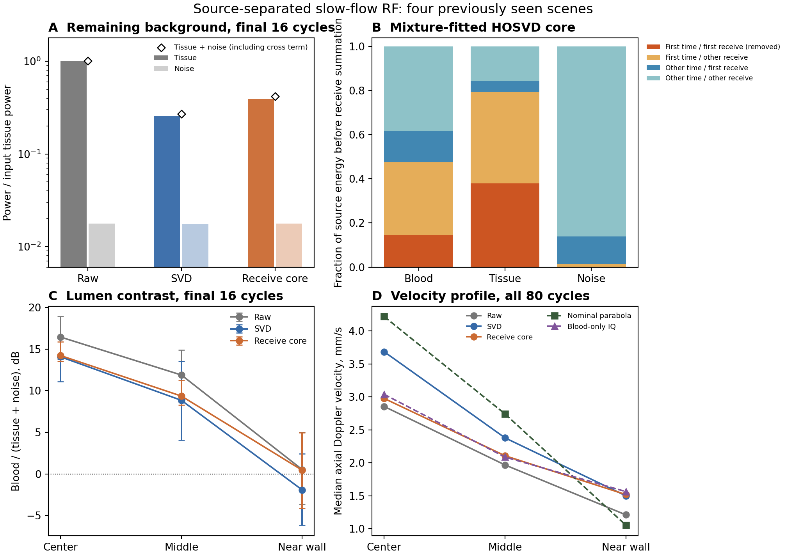

# Receive-core residual source and velocity-profile diagnostic

26 October 2026. [Numerical archive](../runs/receive_core_source_profile_v1/results.json),
[replay code](../scripts/receive_core_source_profile.py),
[configuration](../configs/receive_core_source_profile_v1.json), and
[archive verifier](../scripts/verify_receive_core_source_profile.py).

## Scope and provenance

This is a **retrospective analysis of four previously seen** eSDIva slow-flow
scenes: rigid and smoothly moving tissue in each of scatterer clouds 3907 and
3919. There is no new holdout and no filter tuned to a truth mask. Every
method uses the same 240 RF transmissions: three angles, repeated for 80
cycles at a 3,700 Hz cycle rate, over **about 21.6 ms**. The RF replay divides
64 simulated receive elements into eight contiguous groups of eight, checks
the archived channel, beam and IQ identities, and verifies its source hashes
against the earlier frozen multidimensional archive. Each filter is fitted
to the **mixture** and then applied unchanged to isolated blood, tissue and
noise. The whole-tile final-16-cycle blood error and background power agree
with the previously published [contrast audit](FLOW_BACKGROUND_AUDIT_V1.md).

The actual RF checkpoints live outside the Git repository. The committed
archive carries their component hashes and report hashes; its verifier can
check the report hashes locally but cannot rerun the beamformer in clean CI.
The output archive's calculation and source identities are checked in CI.
No source separation or nominal tube truth enters any filter or cutoff.

## What comprises the 41.8% remaining background?

On the common summed IQ image, the final-16-cycle background decomposition is

\[
\frac{\|T_{out}+N_{out}\|^2}{\|T_{in}\|^2}
=\frac{\|T_{out}\|^2}{\|T_{in}\|^2}
+\frac{\|N_{out}\|^2}{\|T_{in}\|^2}
+\frac{2\operatorname{Re}\langle T_{out},N_{out}\rangle}{\|T_{in}\|^2}.
\]

The cross term is measured, not assumed zero. The table gives **separate
medians of four case scores**, which need not sum to the median of their
per-case totals. Blood retention and background use the same definitions as
the prior audit.

| Method | Blood power kept | Tissue remaining | Noise remaining | Total background | Blood/background |
|:--|--:|--:|--:|--:|--:|
| Unfiltered | 1.000 | 1.000 | 0.018 | 1.016 | −3.40 dB |
| Compounded SVD, discard one | 0.460 | 0.255 | 0.018 | 0.271 | −0.86 dB |
| Receive SVD-a, discard one | 0.510 | 0.211 | 0.018 | 0.226 | +0.47 dB |
| **Receive-core intersection** | **0.800** | **0.396** | **0.018** | **0.418** | **−0.63 dB** |
| Receive HOSVD cutoff adaptation | 0.132 | 0.012 | <0.001 | 0.012 | +1.72 dB |

For receive-core, the per-case tissue fractions are 0.347–0.449, noise
fractions 0.012–0.024, and total background fractions 0.370–0.461. Tissue is
about **96% of tissue-plus-noise power before their cross term**. A
truth-guided thought experiment that removes *all noise with zero blood loss*
would improve the whole-tile ratio by just **0.10–0.40 dB**, median **0.20 dB**,
and still leave 0.347–0.449 tissue power. This is an optimistic diagnostic
bound on noise removal, not a realizable filter. It is far from the 0.10
remaining-background research target.

## Why the receive core leaves tissue

The receive-core rule deletes just the intersection of the **first temporal**
and **first receive** HOSVD factors; all spatial factors are retained. In the
mixture-fitted tensor basis, each isolated source's *full-80-cycle energy*
falls into these four mutually orthogonal sectors. Entries are **means**
across four cases so each source's row sums to one.

| Source | First time, first receive: removed | First time, other receive: kept | Other time, first receive: kept | Other time, other receive: kept |
|:--|--:|--:|--:|--:|
| Blood | 14.4% | 33.0% | 14.4% | 38.1% |
| Tissue | 37.9% | **41.6%** | 4.9% | 15.6% |
| Noise | 0.2% | 1.1% | 12.6% | **86.1%** |

The largest **retained** tissue sector is first-time/other-receive. Simply
rejecting that whole sector would also discard about one-third of blood's
pre-sum aperture-domain energy. The sector percentages cannot be substituted
for final-image blood or tissue power: summing receive groups creates
coherent cross terms between receive factors. Noise mostly survives in the
unsummed tensor but contributes little to the summed image because it is
weak and much less receive-coherent than tissue.

For a separate comparison with [Baranger et al.'s Fig. 4b](https://doi.org/10.1109/TMI.2018.2789499), we projected each
source onto the 80 time patterns of the mixture-fitted **compounded** SVD.
Ranks 61–80 contain **0.013–0.069%** of blood energy, versus **3.2–4.3%**
of noise energy. There is detectable blood in that tail, but considerably
less than in the lower ranks of *these* 80-cycle small-tile simulations;
Baranger's figure cannot supply a universal rank boundary. Our Baranger SSM
implementation on this **8×16 crop** chose a lower boundary of 25–33 and an
upper boundary of 80 in all four cases: its upper noise cutoff did nothing,
while its lower cutoff retained only about 0.1% of blood power. This small
support is not a faithful test of Baranger's full-field experimental regime.

## Near-wall contrast and velocity

The evaluation-only anatomical mask uses the known vessel centre, 2 mm
radius and 60° tilt. On the 8×16 image tile, the normalised in-plane radial
bands contain 32 centre pixels (0–0.5 radius), 16 middle pixels (0.5–0.75),
and **16 near-wall pixels** (0.75–1). The filter never sees those labels.
The final 16 cycles cover about **4.3 ms**; all 80 cycles cover about
**21.6 ms**. The table gives medians across the four cases, taking the dB
ratio inside each case before taking its median.

| Final 16 cycles, near wall | Blood power kept | Pooled blood/background | 10th-percentile pixel ratio | Tissue share of T+N power |
|:--|--:|--:|--:|--:|
| Unfiltered | 1.000 | +0.52 dB | −18.59 dB | 93% |
| Compounded SVD | 0.308 | −1.93 dB | −22.88 dB | 90% |
| **Receive core** | **0.834** | **+0.44 dB** | **−18.69 dB** | **93%** |

The receive-core near-wall pooled ratio spans **−4.15 to +4.93 dB** across
the four scenes. About 41% of near-wall pixels have surviving blood power
above background; many weak pixels remain below it. Even an ideal removal
of noise alone would improve the near-wall pooled ratio by a median of just
**0.21 dB** (case range 0.02–0.71 dB). The centre is different: noise makes
up much of its already small background, and ideal noise removal could add
about 6.4 dB there. The troublesome weak wall pixels are **tissue-limited**.

We estimated axial velocity by lag-one IQ phase, with the saved 3,700 Hz
cycle rate and measured carrier. The nominal Poiseuille profile at the pixel
centres has median velocities **4.22, 2.74 and 1.05 mm/s** from centre to
wall. The **blood-only unfiltered IQ** yields **3.04, 2.09 and 1.56 mm/s**
with all 80 cycles, showing imaging and speckle bias even before filtering.
These two references are therefore reported separately.

| Median absolute per-pixel velocity error versus blood-only IQ | Centre | Middle | Near wall |
|:--|--:|--:|--:|
| Unfiltered, last 16 cycles | 2.73 | 3.20 | **5.67 mm/s** |
| SVD, last 16 cycles | 5.01 | 6.83 | 7.01 mm/s |
| Receive core, last 16 cycles | 3.83 | 6.71 | **8.71 mm/s** |
| Unfiltered, all 80 cycles | 1.02 | 1.00 | **0.88 mm/s** |
| SVD, all 80 cycles | 2.02 | 2.04 | 2.21 mm/s |
| Receive core, all 80 cycles | 1.53 | 1.10 | **1.67 mm/s** |

For all 80 cycles, the *median* receive-core velocity profile is 2.98,
2.11 and 1.52 mm/s, close to the blood-only IQ medians. The per-pixel
errors and weak-pixel ratios show that this visual agreement **does not
establish a reliable near-wall profile**, especially from 16 cycles.
Velocity from the near-zero-blood Baranger-selected output is not meaningful
even if its background power is low. At this very slow flow, a 16-cycle
lag-one estimate is intrinsically noisy; these endpoints do not isolate
filter error from the finite-ensemble variance.

## Decision

The proposed receive-coherence **noise denoiser is not the next useful filter
on these data**: it cannot address the dominant tissue leakage at the wall.
The more focused problem is to distinguish tissue and blood within the
first-time/other-receive sector while preserving the blood already there.
Any subsequent candidate should be compared on *both* the short 16-cycle
window and the full 80-cycle window, using near-wall blood retention,
source-separated tissue power, local blood/background ratio, and per-pixel
velocity error. These retrospective four cases cannot establish prospective
robustness, and the 1 mm lateral grid sparsely samples the 4 mm lumen.
