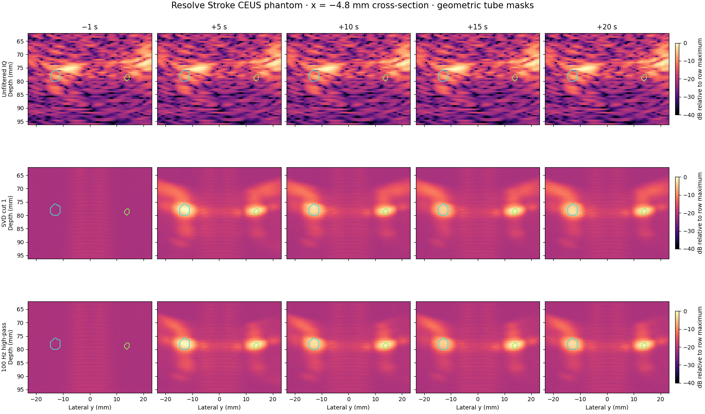

# Resolve Stroke flow-phantom diagnostic: known tube geometry

26 October 2026. This is the completed **single-view CEUS** analysis under the
[fixed exploratory protocol](RESOLVESTROKE_SINGLE_VIEW_PROTOCOL.md). The raw
acquisition comes from [Resolve Stroke/Open-H-RF](https://github.com/open-h/Open-H-RF/blob/main/datasets/resolvestroke/phantom_flow/README.md)
(CC BY 4.0), Hugging Face revision
`05234aa084b27c8e4d0096c3a9adc33fbbc123d8`; the 5,250,744,320-byte
HDF5 SHA-256 is
`40908ca699f3b88d9cdcdc4cabf9f1e07d481baec901b7044132e42c41f768f5`.
The [complete clip/window score report](../runs/resolvestroke_single_view/report.json),
[aggregate linear-power maps](../runs/resolvestroke_single_view/clip_power_maps.npz),
and [artifact/checkpoint manifest](../runs/resolvestroke_single_view/manifest.json)
are archived in this repository. The source HDF5 is not redistributed.

## Geometry and analysis

The dataset's `custom/computed_references/tube_mask` is an anatomical
reference for nominal 4 mm and 2 mm flow tubes. On the fixed section nearest
`x = −5 mm` (actual `−4.8 mm`), the 0.6 mm Cartesian grid has 35 mask pixels
for the 4 mm tube and 9 for the 2 mm tube. Their pixel areas are 12.60 and
3.24 mm², corresponding to area-equivalent diameters **4.005 and 2.031 mm**.
These are checks of the released mask geometry, not new measurements of the
physical tubing or its lumen. The plane spans 57 depth × 77 lateral pixels.

Recorded channel IQ was divided by the recorded hardware TGC curve and
beamformed with Zea 0.1.6 to complex IQ, before envelope or log compression.
Each of five 4,000-frame clips contributes fifteen disjoint 256-frame
windows at 4 kHz; the 80 frames at each clip edge are excluded. The three
matched outputs are unfiltered IQ, global spatial SVD with its first mode
discarded, and a zero-phase third-order 100 Hz Butterworth high-pass. Each
clip's map is the mean of its fifteen linear-power maps. Neither filter uses
the tube mask, and the windows never bridge the unrecorded gaps.

We compare power in each tube mask with pixels at the same depth and at least
two pixels outside either tube. AUC measures tube/outside ranking; the
true-positive fraction uses that outside region's 99th-percentile threshold
(approximately 1% outside false positives). The 2 mm tube has only nine
pixels, so one missed pixel changes its fraction by 0.111. These are
**localization** scores; there is no independently measured blood IQ with
which to calculate blood-signal retention.



Each row of the image uses one common color scale across the five clips,
referenced to that row's maximum. Cyan outlines the 4 mm tube, green the
2 mm tube. The image displays power, not a flow-velocity or WSS estimate.

## Results

Entries below are **4 mm / 2 mm**, computed from the clip-mean power maps.
The raw-IQ true-positive fraction at the fixed outside threshold is zero for
both tubes in all five clips.

| Clip relative to injection | Raw AUC | SVD AUC | 100 Hz high-pass AUC | SVD true-positive fraction | High-pass true-positive fraction |
|---|---:|---:|---:|---:|---:|
| −1 s baseline | 0.7790 / 0.4253 | 0.3154 / 0.1953 | 0.3318 / 0.1945 | 0 / 0 | 0 / 0 |
| +5 s | 0.7887 / 0.4838 | 0.9995 / 0.9968 | 0.9978 / 0.9975 | 1.000 / 0.889 | 0.943 / 0.889 |
| +10 s | 0.7796 / 0.4863 | 0.9988 / 0.9978 | 0.9974 / 0.9982 | 0.971 / 0.889 | 0.886 / 0.889 |
| +15 s | 0.7844 / 0.4910 | 0.9957 / 0.9987 | 0.9925 / 0.9987 | 0.971 / 0.889 | 0.800 / 0.889 |
| +20 s | 0.7842 / 0.4838 | 0.9992 / 0.9987 | 0.9964 / 0.9987 | 1.000 / 0.889 | 0.914 / 0.889 |

For the four post-injection clips, SVD mean tube/outside power contrast spans
**10.46–12.62 dB** for the 4 mm tube and **11.91–13.00 dB** for the 2 mm
tube. The high-pass ranges are **10.28–12.61 dB** and **12.43–13.34 dB**.
Depth-matched outside power, compared with unfiltered IQ in the same clip,
falls by **26.75–27.51 dB / 23.71–24.45 dB** for SVD and
**27.44–27.96 dB / 24.25–24.82 dB** for high-pass (4 mm / 2 mm regions).
Outside power can include sidelobes and scatterers; these ratios should not
be interpreted as a measured tissue-only rejection rate.

Tube power relative to the designated −1 s baseline rises only
**0.00–0.08 dB / 0.52–0.62 dB** in raw IQ, versus
**16.66–19.56 dB / 19.02–19.65 dB** after SVD and
**16.20–19.00 dB / 19.35–19.83 dB** after high-pass. The strong post-injection
localization and the dark baseline are consistent with suppression of static
phantom clutter and detection of changing microbubble-associated signal in
the known tubes. Both conventional filters work well here. The slightly
higher SVD 4 mm threshold fractions in these clips do not establish a
general performance advantage: all clips and 75 windows belong to **one
correlated acquisition**. The full report retains every window score.

## Scope and reproduction

This result uses **one diverging-wave transmit per frame**, an injected
microbubble bolus, and no controlled moving-tissue condition. The supplied
`mvi` and velocity maps were generated by the acquisition pipeline, rather
than independently measured flow truth. The −1 s clip is not documented as a
pump-off tissue-only control. Consequently this study tests tube localization
and baseline response, **not** source-resolved blood preservation, moving
tissue leakage, independent velocity/WSS accuracy, or the frozen phase-10
three-view selector. It is an exploratory diagnostic and not a held-out
physical validation of phase 10.

To verify the portable release without downloading the raw file:

```bash
python scripts/verify_resolvestroke_single_view.py
```

For a full rerun, obtain the pinned `phantom_flow.hdf5` above and verify its
SHA-256. Install this repository with its `io` extra and `zea==0.1.6` with
the JAX CPU backend. The recorded run used Python 3.12.14, JAX 0.7.2,
h5py 3.16.0, hdf5plugin 7.1.0, NumPy 2.5.4, SciPy 1.18.1 and Keras 3.15.1.
The [beamformer configuration](../configs/resolvestroke_complex.yaml) and
[analysis code](../scripts/resolvestroke_single_view.py) are bound by the
[protocol JSON](../configs/resolvestroke_single_view.json), frozen in
[commit `9f42e34`](https://github.com/hacheleroy/blood-tissue-separation-ultrasound/commit/9f42e34e425ea596a40773e6c8ddaf4f0c8f9a20).

```bash
KERAS_BACKEND=jax JAX_PLATFORM_NAME=cpu OPENBLAS_NUM_THREADS=1 \
  python scripts/resolvestroke_single_view.py \
  --input /path/to/phantom_flow.hdf5 --output runs/my_resolvestroke_checkpoints
python scripts/verify_resolvestroke_single_view.py \
  --check-checkpoints runs/my_resolvestroke_checkpoints
```

The manifest lists hashes for all 75 local intermediate checkpoints, while
the portable release includes all window scores and the five aggregate power
maps. Small numerical differences may arise with a different beamforming
stack; exact checkpoint hashes describe the recorded environment.
