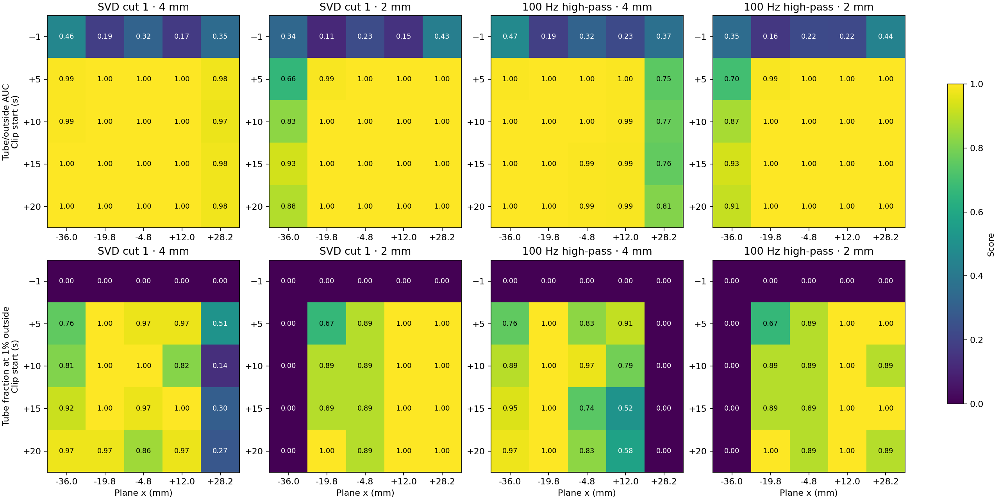
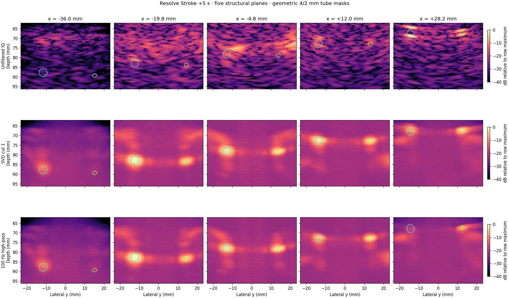
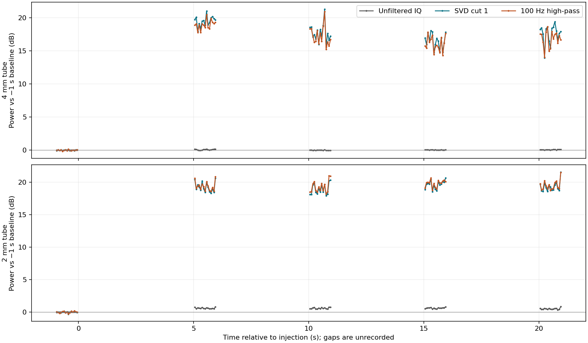

# Resolve Stroke: the center-plane result does not hold uniformly along both tubes

26 October 2026. This is the completed, separately frozen
[five-plane exploratory audit](RESOLVESTROKE_SPATIAL_AUDIT_PROTOCOL.md) of the
same Resolve Stroke/Open-H-RF microbubble-bolus HDF5 analyzed in the
[initial single-plane result](RESOLVESTROKE_SINGLE_VIEW_RESULT.md). The
[analysis freeze](https://github.com/hacheleroy/blood-tissue-separation-ultrasound/commit/558113d447d29918483a1232f48fe461bb1ef486)
declared all five anatomical planes, all fifteen new plane/window pairs,
the three filters and the one-pixel mask changes before the new scores were
examined. The source is CC BY 4.0; retain Resolve Stroke/Open-H-RF attribution.
The [complete score report](../runs/resolvestroke_spatial_audit/report.json),
[five-plane aggregate linear-power maps](../runs/resolvestroke_spatial_audit/clip_plane_power_maps.npz),
[exact center-plane replay](../runs/resolvestroke_spatial_audit/central_plane_replay.json)
and [SHA-256 manifest](../runs/resolvestroke_spatial_audit/manifest.json)
are archived. The large source HDF5 and intermediate window maps are not
redistributed.

## Structural selection and checks

The x planes are **−36, −19.8, −4.8, +12 and +28.2 mm**. Their 4 mm tube
masks contain respectively 37, 37, 35, 33 and 37 pixels; their nominal
2 mm masks contain 9, 9, 9, 10 and 9 pixels on the 0.6 mm y/z grid. The
selection used only the released anatomical coordinates and tube labels.
For each of the five 4,000-frame clips, we reconstructed the predeclared
early, middle and late 256-frame windows through all five planes from the
same original channel-IQ blocks. The raw, SVD cut 1 and 100 Hz high-pass
outputs use identical spatial and temporal support. Each score compares
clip-mean tube power with depth-matched, >2-pixel-guarded outside power.

The new x = −4.8 mm power maps for **all 15 selected windows, all three
methods, and every pixel** reproduce the corresponding original single-plane
checkpoints exactly (maximum absolute difference and relative L2 error
both **zero**). The original report's 75 window means supply the separate
center-plane time course. The new five-plane results are therefore an
anatomical extension of the initial computation, rather than a changed
beamformer or filter.

## Spatial outcome

Each table entry is the **lowest AUC / lowest tube fraction above the
outside 99th percentile** among the four post-injection clips at that
predeclared plane. AUC near one can coexist with poor recall at this
strict outside threshold. These clips are correlated, and the minima are
descriptive; they are not statistical lower confidence bounds.

| x plane (mm) | SVD, 4 mm | SVD, 2 mm | 100 Hz high-pass, 4 mm | High-pass, 2 mm |
|---:|---:|---:|---:|---:|
| −36.0 | 0.995 / 0.757 | **0.663 / 0.000** | 0.995 / 0.757 | **0.698 / 0.000** |
| −19.8 | 0.999 / 0.973 | 0.989 / 0.667 | 0.999 / 1.000 | 0.991 / 0.667 |
| −4.8 | 0.996 / 0.857 | 0.997 / 0.889 | 0.993 / 0.743 | 0.997 / 0.889 |
| +12.0 | 0.997 / 0.818 | 1.000 / 1.000 | 0.989 / 0.515 | 1.000 / 1.000 |
| +28.2 | 0.970 / 0.135 | 0.999 / 1.000 | **0.747 / 0.000** | 0.997 / 0.889 |



At −36 mm, neither filter detects any of the nine 2 mm mask pixels at the
1% outside threshold in any post-injection clip; SVD AUC ranges from
0.663 to 0.931 there. At +28.2 mm, high-pass has **zero** threshold recall
for the 4 mm tube in all four post-injection clips, with AUC 0.747–0.813.
SVD retains AUC 0.970–0.980 for that tube, although its threshold recall
falls to 0.135–0.514. Thus the initially excellent central-plane
localization cannot be generalized across the full channel. These are
fixed-setting observations on one exam, not evidence that SVD is broadly
superior to high-pass. Off-axis sensitivity, bubble occupancy, sidelobes,
flow and mask partial volume could contribute; this analysis does not
isolate a cause.



The designated −1 s clip gives zero tube-pixel recall at the fixed outside
threshold for both filters, both tubes and all five planes. Outside power
relative to unfiltered IQ falls by 17.89–28.80 dB (4 mm depth region) and
16.48–27.68 dB (2 mm region) for SVD across post-injection clips and
planes; the corresponding high-pass ranges are 18.17–31.02 and
16.66–30.22 dB. Outside power is not an isolated tissue measurement.

## Tube-mask and time sensitivity

Every plane/clip was scored with the original tube mask, a one-pixel cross
dilation and four one-pixel translations while keeping the same original
outside ROI. Across all 20 post-injection plane/clip cells, the lowest AUC
among these fixed perturbations was **0.956** for SVD on the 4 mm tube and
**0.535** for SVD on the 2 mm tube; for high-pass the corresponding minima
were **0.650** and **0.552**. The weakest 2 mm case was a +0.6 mm depth
translation at −36 mm. A single grid pixel is a substantial fraction of a
nine-pixel tube. These perturbations describe geometric sensitivity and do
not replace the released ground-truth label.

At the previously analyzed −4.8 mm plane, all fifteen disjoint windows per
clip show the contrast-bolus response. Relative to each method's average
−1 s tube power, the 60 post-injection windows span **13.97–21.32 dB**
for SVD's 4 mm tube and **17.93–21.56 dB** for its 2 mm tube; high-pass
spans **14.06–20.93 dB** and **18.20–21.49 dB**. Raw IQ spans only
**−0.05–0.16 dB** and **0.36–0.84 dB**. The plotted gaps are unrecorded;
there is no interpolated bolus time series between clips.



## What this establishes

Known tube geometry and a baseline-before-bolus label allow localization
and time-response checks, including visible failures at the sampled ends
of the tubes. The dataset remains **one single-transmit contrast-bolus
acquisition** with no matched pump-off/tissue-only capture, controlled
moving tissue or independently measured source blood IQ. Neither the
baseline response nor an AUC measures preservation of *all flow*.
The three-view phase-10 selector and paired moving-tissue/blood gates cannot
be tested on this dataset. Five selected structural planes and three windows
per clip also do not map every voxel or establish independent replication.

Verify the portable report directly from its released power maps:

```bash
python scripts/verify_resolvestroke_spatial_audit.py
```

A full HDF5 rerun uses the frozen
[analysis script](../scripts/resolvestroke_spatial_audit.py) and configuration
under the same Zea 0.1.6 CPU/JAX stack as the first result. The manifest
records hashes for all fifteen local multi-plane checkpoints; add
`--check-checkpoints /path/to/checkpoints` to verify a locally reproduced
run. A new physical acquisition must measure the missing source/control
conditions independently.
