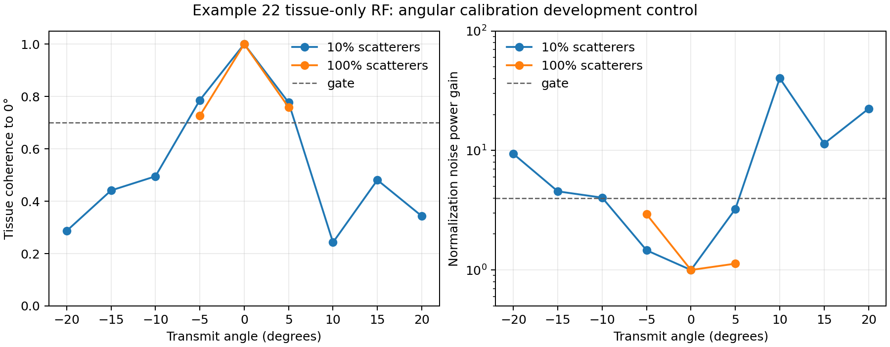
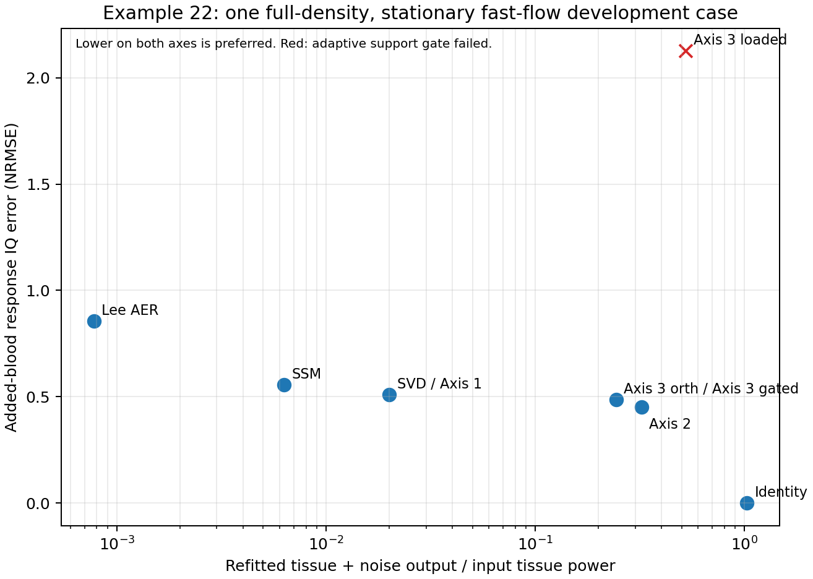

# eSDIva angular calibration and full-density short control

24 October 2026. Development result on the pinned
[eSDIva Example 22](https://github.com/EstebanRivera08/eSDIva/tree/ab7eaef6d23428762ab5b9079ab03a5aa99af085/examples/example22_flow_doppler)
at `ab7eaef6d23428762ab5b9079ab03a5aa99af085`. The [earlier v08 pilot](RESULTS_ESDIVA_PILOT_V08.md)
used `-15°, 0°, +15°` and 10% of the particles. Its nearly zero cross-view
regression coefficient caused large input normalization gain. This study tests
the angular model before committing to a long ensemble. It is still **one
stationary-tissue, fast-flow development scene, not a held-out benchmark**.

## Tissue angle control

The [angle diagnostic](../examples/esdiva_angle_calibration.py) acquires
tissue-only RF, beamforms each view separately, estimates one carrier from the
first eight frames and audits the next eight. The same fixed tissue scatterers
repeat in both halves, so this validates temporal replay and receiver geometry
on this scene; it is **not an independent texture or seed test**. The sparse
survey fires all nine angles with the 0° reference first. The full-density
control fires only `0°, -5°, +5°`, the order used in the source-resolved case.
The [exact survey and full-density manifests](../runs/esdiva_calibration_v09/)
contain RF/IQ hashes and the diagnostics for every selected angle.

| Tissue control, relative to 0° | -5° coherence | +5° coherence | -5° input noise-power gain | +5° input noise-power gain |
|:--|--:|--:|--:|--:|
| Nine-angle survey, 10% particles | 0.786 | 0.777 | 1.46 | 3.24 |
| Three-angle control, 100% particles | 0.726 | 0.759 | 2.93 | 1.13 |

The declared angle gate requires the first view to be 0°, coherence at least
0.70 on both temporal halves, and scalar-normalization noise-power gain at
most 4. The full-density three-angle control passes. The nine-angle survey
fails because several wider views have coherence below 0.5; this does not
prove a universal angular limit for other scenes or reconstruction grids.
Regression gain equals cross-view coherence times the view RMS amplitude
ratio. Dividing by a small regression gain therefore amplifies decorrelated
view content and noise. A phase-plus-RMS alternative is recorded for diagnosis,
but no method output here silently substitutes it for the shared calibrator.

Dashed lines mark the declared input gate. The full-density curve has only the
three acquired angles. These tissue-only results do not measure blood response.

## Full-density source-resolved control

The [same RF-to-IQ adapter](../examples/esdiva_example22_pilot.py) acquired
**120 three-angle events per source**: eight disjoint calibration frames,
32 evaluation frames, and 16 scored after a 16-frame history. It retained all
4,560 tissue and 6,180 blood scatterers generated by Example 22. A 6 dB
receiver-noise realization has one absolute scale over calibration and test.
The calibration IQ includes tissue and noise only; filtering receives the
mixture, geometry, and the outer `|x| >= 6 mm` annotation. Blood and tissue
components enter only evaluator controls.

| Acceptance check | Value |
|:--|--:|
| RF isolated sum versus independent combined event, relative error | 2.56 × 10⁻⁷ |
| Beamformed isolated sum versus combined beamform, relative error | 4.61 × 10⁻⁸ |
| IQ isolated sum versus combined beamformed IQ, relative error | 1.74 × 10⁻⁷ |
| Calibration-derived received carrier | 2.618 MHz |
| Blood/tissue power in guarded training ROI | 0.00921 |
| Blood/tissue power in central flow ROI | 192 |
| Noisy calibration coherence, -5° / +5°, first half | 0.709 / 0.745 |
| Noisy calibration coherence, -5° / +5°, second half | 0.716 / 0.739 |
| Noisy calibration scalar noise-power gain, -5° / +5° | 3.16 / 1.22 |

The mixture input gate passes, but 0.709 is close to its 0.70 threshold. The
[full short-control record](../runs/esdiva_calibration_v09/report.json) includes
all settings, hashes, phase checks and frozen component diagnostics. Its
numerical source fingerprint is the v08 value
`8587a156b3283238920777e96cd059d72203d5a9638a61f5cc43876324cd4e13`;
historical v07/v08 archives were not changed.

## Matched counterfactual replay

The [replay script](../examples/esdiva_replay_iq.py) fits each method once on
the mixture and once on **tissue plus the identical receiver-noise realization**,
using the same calibration, training ROI, geometry, frames and 16-frame packet.
The difference between those separately refitted outputs is the response to
adding blood. Its IQ error is measured against the isolated blood component.
This source-resolved counterfactual is an evaluation-only simulator control;
an unknown clinical mixture does not provide it.
The background column is the tissue-plus-noise refit output power divided by
input tissue power. Both columns are needed: identity has exact paired blood
response yet rejects no background. They measure different properties from
frozen component attribution, which is retained in the [replay record](../runs/esdiva_calibration_v09/replay.json).

| Method at this one fixed setting | Added-blood IQ NRMSE ↓ | Refitted background power ratio ↓ | Frozen blood power ratio | Status |
|:--|--:|--:|--:|:--|
| Identity | 0.000 | 1.025 | 1.000 | Control |
| Global SVD, discard 1 | 0.510 | 0.0200 | 0.965 | Exploratory |
| Baranger SSM | 0.557 | 0.00627 | 0.858 | Exploratory |
| Axis 1: Motion-compensated virtual long ensemble | 0.510 | 0.0200 | 0.965 | Equals SVD at a one-packet horizon |
| Axis 2: Motion-demodulated multi-lag separation | 0.450 | 0.321 | 0.613 | Exploratory |
| Axis 3: Local ultrasound STAP, orthogonal | 0.487 | 0.243 | 0.809 | Exploratory |
| Axis 3: Local ultrasound STAP, loaded | 2.127 | 0.523 | 5.865 | **Support/gain gate failed** |
| Axis 3: Local ultrasound STAP, gated loaded | 0.487 | 0.243 | 0.809 | Orthogonal fallback selected from data-only diagnostics |
| Stephen Lee AER, temporal, ε=26 | 0.856 | 0.000775 | 0.029 | Regularization carried over without acoustic retuning |

Loaded STAP has a 48-dimensional angle-time snapshot and only 31–40 guarded
training samples, against the predeclared minimum of 96; its largest operator
gain is 20.4 against the 1.5 limit. The apparent frozen blood power gain is
therefore distortion/amplification, not preservation. The
[fail-closed eSDIva wrapper](../examples/esdiva_gated_stap.py) fits the
candidate from observations only, checks both limits, then substitutes the
orthogonal projector on this case. It repeats that decision on the separately
refitted background control and reproduces the orthogonal output exactly.
This is a safe fallback, **not an adaptive STAP improvement**. SVD and Axis 1 coincide
because a single 16-frame packet makes the exponential packet weights uniform.
The supplied AER regularizer suppresses background strongly while attenuating
the added-blood response; the result cannot be generalized to AER with another
training-only regularization rule or to microbubble ULM. None of these rows
selects a winner from a single development seed.

## Decision and reproduction

The narrower angular input is usable for development, but an adaptive Axis 3
benefit is **not established or eligible for the long moving-tissue benchmark
yet**. The runner now fails closed to orthogonal STAP. Increase its
history/training support while keeping the spatial guard, then recheck the
adaptive operator gain, blood response and noise on a new development acquisition.
Then run moving tissue, slow flow, and zero-flow controls; freeze numerical
code, reconstruction, settings and acceptance rules before independent seeds.
ULMShare is a [later in vivo microbubble tier](ULMSHARE_FOLLOWON.md), after this
acoustic validation, and lacks isolated blood/tissue source truth.

To reproduce the compact controls with eSDIva installed at the pinned commit,
run the two angle diagnostics with `--view-indices 4 0 1 2 3 5 6 7 8
--scatterer-fraction .1` and `--view-indices 4 3 5 --scatterer-fraction 1`,
respectively, each into a new output JSON. Run the pilot with
`--view-indices 4 3 5 --calibration-frames 8 --evaluation-frames 32
--scatterer-fraction 1 --require-calibration-gate` into a new directory, then
pass that directory to `esdiva_replay_iq.py`. The RF/IQ arrays and per-event
checkpoints are intentionally outside Git; their hashes are in the records.
