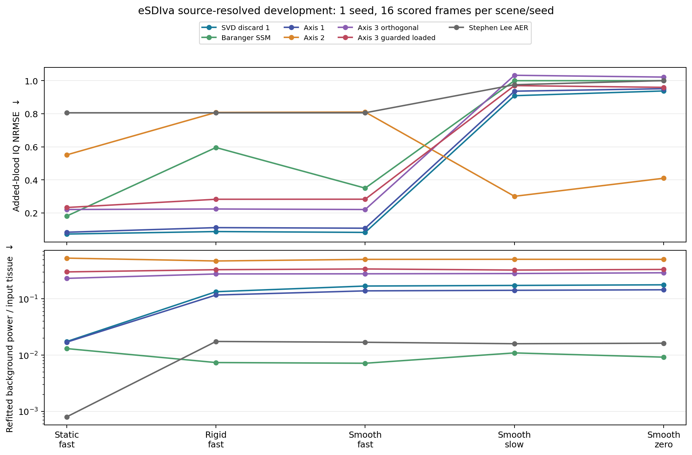

# eSDIva longer-ensemble development controls

24 October 2026. Five **development** scenes share scatterer seed 2026, the
[locked acquisition and scoring protocol](ESDIVA_PHASE2_PROTOCOL.md), and the
same `0°, -5°, +5°` uncompounded view order. These are 10%-density acoustic
simulations, 16 disjoint calibration frames plus 80 evaluation frames, with
only the last 16 evaluated after 64 history frames. The compact
[source and score records](../runs/esdiva_phase2_development/) contain the
parameter, RF/IQ, array and numerical-code hashes. Raw checkpoints and IQ
remain outside Git. The [freeze manifest](../configs/esdiva_phase2_freeze.json)
seals these records, settings and code before either reserved scatterer seed
2031 or 2053 is opened.

All five pass the source and input gates: the largest independent RF/beam/IQ
additivity error is 1.73×10⁻⁷ (limit 2×10⁻⁴), the minimum temporal-half
angle coherence is 0.758 (limit 0.70), the largest regression-normalization
noise-power gain is 3.38 (limit 4), and blood/tissue power in the guarded
tissue ROI is 0.0055–0.0273 (limit 0.1). A previously truncated rigid IQ ZIP
was preserved outside Git, regenerated from its RF checkpoints, verified as
an intact 10-entry archive, and found to have **identical source-array hashes**
to the first acquisition report. Only the verified archive was scored.

## Paired blood response and tissue leakage

Each cell is **added-blood IQ NRMSE / refitted background output power divided
by input tissue power**; both lower is better. The mixture and the separately
acquired tissue-plus-identical-noise control are fitted independently using
only observed IQ and the common calibration. Stationary fast uses the `none`
motion mode, all moving scenes use the conservative spatially gated `smooth`
mode. Isolated blood and known scatterer displacement are evaluator-only.

| Fixed method | Static fast | Rigid fast | Smooth fast | Smooth slow | Smooth zero |
|:--|--:|--:|--:|--:|--:|
| Global SVD discard 1 | 0.073 / 0.017 | 0.088 / 0.134 | 0.083 / 0.169 | 0.909 / 0.174 | 0.937 / 0.178 |
| Baranger SSM | 0.181 / 0.013 | 0.596 / 0.007 | 0.350 / 0.007 | 0.999 / 0.011 | 0.999 / 0.009 |
| Axis 1: Motion-compensated virtual long ensemble | 0.084 / 0.017 | 0.111 / 0.117 | 0.108 / 0.139 | 0.936 / 0.142 | 0.951 / 0.145 |
| Axis 2: Motion-demodulated multi-lag separation | 0.551 / 0.532 | 0.808 / 0.473 | 0.810 / 0.506 | 0.301 / 0.507 | 0.410 / 0.506 |
| Axis 3: Local ultrasound STAP, orthogonal | 0.221 / 0.232 | 0.224 / 0.278 | 0.221 / 0.280 | 1.032 / 0.283 | 1.021 / 0.292 |
| Axis 3: Local ultrasound STAP, guarded loaded | 0.233 / 0.302 | 0.283 / 0.331 | 0.283 / 0.341 | 0.970 / 0.326 | 0.959 / 0.334 |
| Stephen Lee AER, temporal ε=26 | 0.805 / 0.0008 | 0.805 / 0.017 | 0.805 / 0.017 | 0.975 / 0.016 | 1.000 / 0.016 |

The 64-frame history raises guarded STAP's **nominal** minimum support from
31–40 in the previous short full-density control to 124 against a required 96
for its 48-dimensional snapshot. Loading 3.0 keeps maximum fitted operator
gain at 1.370–1.456 under the 1.5 limit; mixture and background arms select
adaptive STAP in every development scene. This establishes the **numerical
support and gain gate**, not an improvement in separation: adaptive STAP has
greater tissue leakage than orthogonal STAP in every row, and does not jointly
improve both primary outcomes. The nominal samples share time and space and
are not independent training observations. The loaded setting remains a
guarded diagnostic, not a promoted method.

The two flow levels reveal a hard limit. SVD and Axis 1 retain a low added-
blood error on fast flow but reach roughly 0.9–0.95 on slow and stationary
blood. Axis 2 reduces that error to 0.301/0.410 on the last two scenes, but
passes about half the input tissue power. Stephen Lee AER at the supplied
ε=26 suppresses background strongly while removing much of the blood
response. No row establishes a generally superior filter or optimizes AER
for this acoustic input. The zero-flow scene still has stationary blood
scatterers and is a deliberate separability stress control.

## Motion gate and rejected development relaxation

With the frozen 0.12 spatial-validation ceiling, the mixture registration
accepts 1/80 stationary frames and **0/80 in each moving scene**. It therefore
falls back to zero displacement; geometric RMSE against prescribed scatterer
transport is 0.335 pixels on rigid and 0.334 on the smooth scenes, equal to
the zero-map reference. The background-only counterfactual independently
accepts one rigid frame, which slightly changes the paired score. The
scatterer transport is not an exact ground-truth image warp.

A separate [0.30-ceiling development diagnostic](../configs/esdiva_phase2_motion_relaxation_dev.json),
with [static](../runs/esdiva_phase2_development/stationary_fast/motion_relaxation_score.json)
and [rigid](../runs/esdiva_phase2_development/rigid_fast/motion_relaxation_score.json)
records, accepted 43/80 rigid frames but only 1/80 stationary frames. On rigid
motion its geometric RMSE fell from 0.335 to 0.237 pixels, and SVD tissue
leakage fell from 0.134 to 0.086. Yet SVD added-blood IQ NRMSE rose from
0.088 to 0.310 (Axis 1: 0.111 to 0.314). This is why the relaxed gate was
**rejected before held-out seeds**. Improved displacement alone cannot
justify blood distortion. The conservative gate is retained without
claiming motion compensation was repaired on this RF simulator.

## Freeze and limits

The [manifest](../configs/esdiva_phase2_freeze.json) fixes the numerical
source, acquisition/score/plot and gate code, both configs, five development
source reports and scores, and the rejected motion diagnostic. Its runner
checks those hashes, the upstream commit, scene and seed before any reserved
RF acquisition, and verifies acquisition provenance before scoring.

These five related scenes are one scatterer seed with 16 scored frames each.
They cannot support population significance, full-density performance,
experimental motion accuracy, or a physical-phantom claim. The next comparison
must use the **unchanged** settings on the two reserved seeds and publish
failed strata as well as successful ones. Only afterward should a full-density
confirmation and the independent physical phantom be planned. ULMShare is a
later microbubble/in vivo tier with different truth availability.
