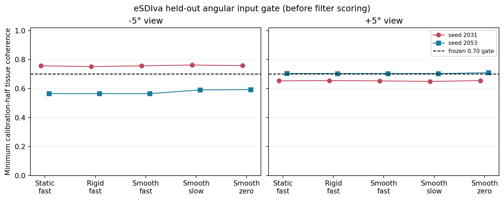

# eSDIva frozen held-out input-gate result

24 October 2026. The [pre-held-out freeze](../configs/esdiva_phase2_freeze.json)
was published as [`0075beb`](https://github.com/hacheleroy/blood-tissue-separation-ultrasound/commit/0075beb22d89a4965312af831bb4f04f78cd94ab)
before opening reserved scatterer seeds **2031 and 2053**. Its
[Actions run #15](https://github.com/hacheleroy/blood-tissue-separation-ultrasound/actions/runs/40107169221)
passed Python 3.10/3.12 tests and package verification. The frozen runner
checked the exact source, settings, development evidence, upstream commit,
scene and seed before acquiring either reserved RF record. It then acquired
all five [locked scenes](ESDIVA_PHASE2_PROTOCOL.md) for each seed at the same
10% particle fraction, 16 calibration frames and 80 evaluation frames.
This is a **held-out input-eligibility result, not a filter comparison**.

| Reserved seed | Scene | Minimum −5° coherence | Minimum +5° coherence | Largest scalar noise-power gain | Frozen gate |
|--:|:--|--:|--:|--:|:--|
| 2031 | Stationary fast | 0.757 | **0.653** | 2.18 | Fail |
| 2031 | Rigid fast | 0.751 | **0.655** | 2.12 | Fail |
| 2031 | Smooth fast | 0.757 | **0.653** | 2.18 | Fail |
| 2031 | Smooth slow | 0.762 | **0.649** | 2.15 | Fail |
| 2031 | Smooth zero | 0.758 | **0.655** | 2.33 | Fail |
| 2053 | Stationary fast | **0.565** | 0.704 | 2.93 | Fail |
| 2053 | Rigid fast | **0.565** | 0.703 | 2.93 | Fail |
| 2053 | Smooth fast | **0.565** | 0.703 | 2.93 | Fail |
| 2053 | Smooth slow | **0.590** | 0.703 | **4.24** | Fail |
| 2053 | Smooth zero | **0.593** | 0.709 | 3.28 | Fail |

The predeclared gate requires **at least 0.70 coherence in both temporal
halves of both nonreference angles** and scalar normalization noise-power
gain **at most 4**. The table shows the smaller of the two temporal-half
coherences per angle. One scatterer seed consistently fails the +5° view;
the other fails −5°. The five scenes per seed share a calibration texture,
so this is **0/2 independent eligible seeds**, not ten independent failures.
The [machine-readable summary](../runs/esdiva_phase2_heldout/summary.json)
and [ten individual reports](../runs/esdiva_phase2_heldout/) preserve both
temporal halves, angle gains, geometry, RF/IQ and source hashes.

The input failure is distinct from an acquisition or source-separation
corruption: all ten RF, beamformed and IQ isolated-sum checks are below
1.8×10⁻⁷ relative error, against the 2×10⁻⁴ limit. The ZIP IQ archives have
ten valid entries each. Blood/tissue power in the guarded tissue ROI is
0.0054–0.0947, below its 0.1 limit. Seed 2053's smooth-slow case also
exceeds the scalar-normalization gain limit (4.24 versus 4), but the
coherence failure already makes every scene ineligible. No filter received
source truth or known displacement.

The runner stops before scoring whenever calibration fails. Accordingly,
there are **no held-out method score files** and no valid blood preservation,
tissue leakage, motion-compensation, loaded STAP, SVD, SSM, Axis 1/2/3, or
Stephen Lee AER ranking from these seeds. The five-scene [development
results](RESULTS_ESDIVA_PHASE2_DEVELOPMENT.md) remain development evidence
only. Relaxing the 0.70 threshold or choosing a better-looking angle from
these reserved seeds would convert them into tuning data; neither was done.

## Decision and next iteration

The selected `0°, −5°, +5°` reference geometry failed cross-seed input
eligibility at reduced particle density. Next, use **new development seeds**
to assess angular speckle coherence and normalization stability across
candidate physically acquired view sets, tissue ROIs and particle densities.
Keep temporal calibration and a disjoint validation segment, and test whether
an alternative calibration model preserves blood and noise before choosing a
new three-view geometry. Freeze that reconstruction, numerical code,
thresholds and all method settings, then reserve **new, untouched seeds** for
its evaluation. Seeds 2031 and 2053 remain failed evaluation evidence and
must not be recycled to select the next operating point.

If a new angular input passes, repeat the paired blood-response/background
comparison on moving-tissue, slow-flow and zero-flow strata. The development
motion gate currently rejects RF tissue motion; the numerically supported
adaptive STAP has no demonstrated separation gain over orthogonal STAP.
Those issues still require development work before phantom validation.
ULMShare remains a later in vivo microbubble tier, with a different truth
contract from this native blood/tissue simulator.
