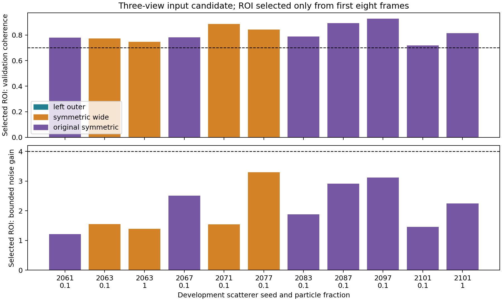
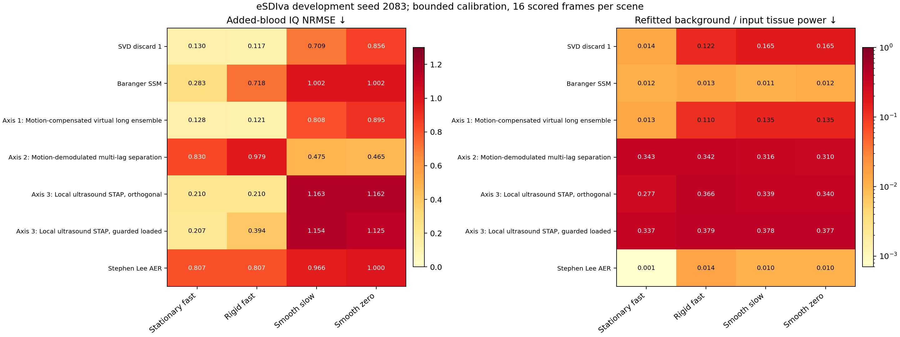

# eSDIva cross-seed angular input repair: development result

24 October 2026. The [phase-2 held-out seeds](RESULTS_ESDIVA_PHASE2_HELDOUT.md)
2031 and 2053 failed their frozen angular input gate and were never used for
this iteration. This page records a **new development study**, not a held-out
filter ranking. Reserved seeds 2081 and 2093 have not been opened. All RF is
from pinned eSDIva Example 22 (`ab7eaef6d23428762ab5b9079ab03a5aa99af085`),
with three individually beamformed `0°, −5°, +5°` emissions per frame. The
compact [survey reports](../runs/esdiva_phase3_angle_development/) preserve
scatterer seeds, RF/IQ hashes, view geometry, tissue ROI diagnostics and both
eight-frame temporal calibration halves; raw RF and IQ remain outside Git.

## The fixed ROI repair failed

An initial nine-angle survey on new reduced-density seeds 2061, 2063 and 2067
showed that cross-angle coherence varies markedly with the sampled tissue
cloud and lateral training pixels. Exact three-view replays motivated a fixed
left-side tissue ROI, `x ≤ −6 mm`, in place of the old `|x| ≥ 6 mm` ROI. It
passed the old 0.70 coherence and 4.0 scalar-normalization gain limits on
these three **exploratory** seeds. Before the next checks, the
[fixed-ROI decision rule](../configs/esdiva_phase3_development_gate.json)
required new seeds 2071 and 2077 plus full-density seed 2063.

That rule **failed**. Seed 2071's left-side +5° coherence was 0.579 and its
scalar gain 4.76; seed 2077's left-side gain was 5.59. At full density,
seed 2063's left-side gain was 5.95. The
[fixed-ROI figure](figures/esdiva_phase3_fixed_roi.png) shows the two-angle
minimum coherence and maximum gain, including the rejected conditions.
Choosing the best-looking side from any one cloud does not establish a
portable fixed ROI.

## A data-only selector and the spatial-support correction

The [input selector](../examples/esdiva_phase3_input_gate.py) examines four
predefined geometric tissue ROIs using only the first eight tissue-plus-noise
calibration frames. It selects the region with the highest *minimum* ±5°
coherence among regions meeting a 0.70 first-half coherence floor and a 4.0
input noise-power bound. It then tests the chosen region against 0.70 on the
second eight frames, **without reselecting**. The halves have distinct noise
but share stationary tissue scatterers. Isolated blood is opened afterward
only by the evaluator to check that the selected ROI's blood/tissue power is
at most 0.1.

The [phase-and-RMS calibration candidate](../examples/esdiva_phase3_bounded_context.py)
keeps each view's measured tissue amplitude while fitting its relative phase
on the first half. Ordinary scalar regression reduces gain as coherence drops;
its inverse can magnify input noise. RMS fitting does not remove angular
decorrelation, and its validation residual is recorded. It still needs paired
blood-response tests; a passed input gate alone cannot establish separation.

An initial selector allowed 24 tissue pixels. It passed fresh development
seeds 2083 and 2087 and one full-density check, but a complete stationary
scene selected only 24 pixels and yielded **60** nominal guarded loaded-STAP
training samples versus the required **96**. The numerical wrapper correctly
fell back to orthogonal STAP. The [initial selector plot](figures/esdiva_phase3_adaptive_roi.png)
records its input behavior, which alone hid the support problem. That
candidate was not frozen. The
[supported rule](../configs/esdiva_phase3_supported_input_dev.json) requires
at least **40 ROI pixels**; it effectively selects the original outer
symmetric ROI or the wider `|x| ≥ 5 mm` ROI on this tile. The change was made
before opening new development seeds 2097 and 2101.

| Development cloud | Particle fraction | Selected ROI | Validation coherence, weaker view | Bounded noise-power gain, larger view | Blood/tissue power in ROI |
|--:|--:|:--|--:|--:|--:|
| 2061 | 0.1 | Outer symmetric | 0.779 | 1.21 | 0.005 |
| 2063 | 0.1 | Wider symmetric | 0.772 | 1.55 | 0.012 |
| 2067 | 0.1 | Outer symmetric | 0.782 | 2.51 | 0.004 |
| 2071 | 0.1 | Wider symmetric | 0.886 | 1.54 | 0.020 |
| 2077 | 0.1 | Wider symmetric | 0.844 | 3.30 | 0.001 |
| 2083 | 0.1 | Outer symmetric | 0.788 | 1.88 | 0.002 |
| 2087 | 0.1 | Outer symmetric | 0.893 | 2.91 | 0.004 |
| **2097, new development check** | 0.1 | Outer symmetric | **0.928** | **3.12** | **0.001** |
| **2101, new development check** | 0.1 | Outer symmetric | **0.719** | **1.45** | **0.014** |
| 2063 | 1.0 | Wider symmetric | 0.747 | 1.40 | 0.025 |
| 2101 | 1.0 | Outer symmetric | 0.814 | 2.25 | 0.003 |

Both new sparse development checks passed the [supported-rule summary](../runs/esdiva_phase3_angle_development/supported_roi_summary.json).
Seed 2101 has only 0.019 coherence margin at 10% density, though its separate
full-density acquisition reached 0.814. The five original scenes per
scatterer seed are correlated, and these calibration halves do not create new
independent tissue textures. Two full-density clouds cannot establish
population eligibility.

## Paired blood response on a complete 80-frame development scene

The unmodified [phase-2 RF acquisition](../examples/esdiva_phase2_acquire.py)
was reused on development seed 2083, keeping 16 calibration and 80 evaluation
frames, the same 6 dB receiver noise construction, isolated RF source
additivity checks, 64-frame filter history and last 16 scored frames. The
[phase-3 scorer](../examples/esdiva_phase3_score.py) replaces only the
calibration ROI/model, holding all [filter settings](../configs/esdiva_phase2_development.json)
fixed. It fits mixture and tissue-plus-identical-noise background separately.
The two primary values below are **added-blood IQ NRMSE / refitted background
output power divided by input tissue power**; lower is better on each. Each
scene shares one scatterer cloud, so these are four related development
conditions, not four independent replicates.

| Fixed method, bounded calibration | Stationary fast | Rigid fast | Smooth slow | Smooth zero |
|:--|--:|--:|--:|--:|
| Global SVD discard 1 | 0.130 / 0.014 | 0.117 / 0.122 | 0.709 / 0.165 | 0.856 / 0.165 |
| Baranger SSM | 0.283 / 0.012 | 0.718 / 0.013 | 1.002 / 0.011 | 1.002 / 0.012 |
| Axis 1: Motion-compensated virtual long ensemble | 0.128 / 0.013 | 0.121 / 0.110 | 0.808 / 0.135 | 0.895 / 0.135 |
| Axis 2: Motion-demodulated multi-lag separation | 0.830 / 0.343 | 0.979 / 0.342 | 0.475 / 0.316 | 0.465 / 0.310 |
| Axis 3: Local ultrasound STAP, orthogonal | 0.210 / 0.277 | 0.210 / 0.366 | 1.163 / 0.339 | 1.162 / 0.340 |
| Axis 3: Local ultrasound STAP, guarded loaded | 0.207 / 0.337 | 0.394 / 0.379 | 1.154 / 0.378 | 1.125 / 0.377 |
| Stephen Lee AER, temporal ε=26 | 0.807 / 0.001 | 0.807 / 0.014 | 0.966 / 0.010 | 1.000 / 0.010 |

All four 2083 scenes passed the new input gate, with RF source-additivity
errors about 1.4×10⁻⁷ and evaluator-only blood/tissue power about 0.0014–0.0020
in the selected tissue ROI. The supported region restored **124** nominal
guarded loaded-STAP samples against 96 required; fitted gain stayed below
1.5. Yet loaded STAP leaked more tissue than orthogonal STAP in all four
bounded-calibration scenes and had substantially worse added-blood error
under rigid motion. It is still a diagnostic, not a promoted filter.

Using the same first eight calibration frames for regression and phase-RMS
controls, bounded calibration slightly reduced SVD's paired errors on the
stationary, rigid, slow and zero cases (for example slow-flow blood NRMSE
0.730 → 0.709, background ratio 0.175 → 0.165). It is **not universally
better**: Baranger SSM and the loaded-STAP tissue leakage worsen in several
cases. The conservative motion gate accepted **0–1 of 80** rigid/slow/zero
frames per fit, so Axis 1 has not demonstrated repaired RF motion tracking.
With slow or stationary blood, SVD/Axis 1 retain large blood error, Axis 2
trades some preservation for tissue leakage, and AER at the inherited ε
strongly suppresses background while losing the added-blood response. The
zero-flow stress case still contains stationary blood scatterers.

## Decision

The input selector is a promising **development-only eligibility repair**.
The current filter and motion behavior does not justify promoting loaded
STAP, bounded calibration as a universal replacement, or the three research
axes as superior to SVD/AER. The untouched reserve 2081/2093 should only be
opened after a complete numerical and method-settings freeze with an explicit
comparison aim. Before that, repair RF motion tracking against a paired
blood-response criterion and develop a slow-flow operating point without
claiming zero-flow separability. The additional full-density seed 2101 passes
the input gate; a larger independent density study and later physical phantom
remain necessary. ULMShare is a later in vivo
microbubble tier with a different truth contract.
