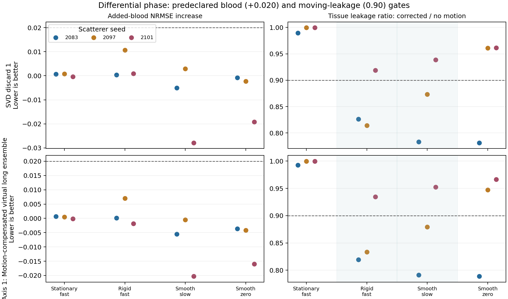
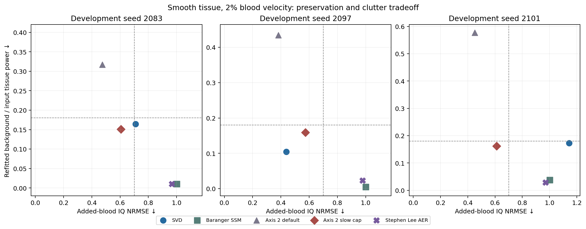

# eSDIva RF phase tracking and slow-flow operating point

24 October 2026. This study reuses the pinned Example 22 RF acquisition,
three separately beamformed 0°, −5°, +5° views, 16 disjoint stationary
calibration frames, 80 evaluation frames and the last 16 frames after a
64-frame filter history. The four conditions for each scatterer seed share
the same cloud. The [first fixed candidate](../configs/esdiva_phase4_candidate_v1.json)
was set from design seed 2083 before the full seed-2097 replay. The
[revised candidate and decision rule](../configs/esdiva_phase4_candidate.json)
were set using both design clouds before a full seed-2101 replay. Isolated
tissue, blood, receiver noise and prescribed motion are available only to the
evaluator. A method receives the mixture or an independent tissue-plus-noise
background fit, the same calibration, geometry and selected geometric tissue
ROI. Values are **paired added-blood IQ NRMSE / refitted background output
power divided by input tissue power**; lower is better for each value.
Seed 2101 had a short input-only angular survey in phase 3; its 80-frame
paired method responses had not been examined when this revision was fixed.

## Why spatial RF motion repair was rejected

The inherited complex-IQ spatial registration gate accepts only 1/80 frames
on the rigid design scene. An envelope registration accepts 35/80 rigid or
41/80 smooth frames, and improves the geometric displacement RMSE from the
zero map's 0.335 pixel to 0.271 or 0.266 pixel. Geometric displacement is
only a scatterer-transport reference, not exact beamformed-IQ image motion.
The inverse bilinear warp, however, damages the paired blood response:
roundtrip added-blood NRMSE rises from approximately zero to 0.469 or 0.454.
SVD's blood NRMSE rises from 0.116 to 0.471 or 0.449, even as background
leakage falls from 0.122 to 0.047–0.048. A displacement gate by itself is
therefore insufficient. The [rejected candidate code](../examples/esdiva_phase4_motion_context.py)
and [paired diagnostic](../runs/esdiva_phase4_development/2083_exploratory/motion_rigid.json)
preserve this negative result.

## A phase-only tissue tracker

The candidate measures each RF-derived IQ view's tissue phase on one part
of the geometric ROI and checks coherence and phase agreement on disjoint
pixels. It subtracts the circular mean across views and applies a continuous
deadband and confidence weight. The revised candidate scales that weighted
phase by a fixed 0.50. The phase factor has unit magnitude, so it
does not resample the blood IQ; a paired roundtrip must have essentially zero
error. The [implementation](../examples/esdiva_phase4_differential_context.py)
uses calibration and the current observed frame only. The earlier hard
accept/reject per-view phase gate gave discontinuous corrections and worsened
stationary blood error, and was not selected. Neither phase method estimates
a spatial displacement field. This is a phase-decorrelation repair, not a
validated geometric motion measurement. The fit and validation pixel sets
do not overlap, although nearby RF speckle can remain correlated.

## Separate slow-flow setting

The default Axis 2: Motion-demodulated multi-lag separation uses rank 4 and
gain cap 1.0. The first rank-6, 0.45 gain-cap setting failed the independent
development slow-flow tissue bound (0.204 on seed 2097 against 0.180).
The revised **smooth, 2% original blood speed** setting keeps rank 4 and
reduces its gain cap to 0.40. It gives 0.606 / 0.151 on seed 2083 and
0.574 / 0.159 on seed 2097 (blood NRMSE / tissue leakage), compared with
their default Axis 2 results of 0.474 / 0.317 and 0.382 / 0.434. This is
a deliberate tradeoff with unchanged bounds of at most 0.700 blood NRMSE
and 0.180 leakage. It is not deployed for ordinary fast flow: capped Axis 2
strongly distorts its added blood on the design clouds. Zero flow is reported
as a non-identifiable stress case, with no separability promise.

Baranger SSM and Stephen Lee AER (temporal ε=26) retain their inherited
settings. On design-seed slow flow, SSM gives 1.002 / 0.011 and AER gives
0.966 / 0.010. They remove much background while losing the added-blood
response. Global SVD discard 1 and Axis 3: Local ultrasound STAP remain
controls; the STAP setting here is orthogonal, with guarded loaded STAP
still a non-promoted phase-3 diagnostic.

## Prospective development and decision

The declared decision requires the supported calibration input gate and
exact roundtrip, no more than 0.02 blood-NRMSE increase for phase correction
in any of the four conditions with SVD or Axis 1: Motion-compensated virtual
long ensemble, at least 10% background leakage reduction in rigid fast and
smooth slow scenes for both, and both slow-specific Axis 2 bounds. All four
conditions on both design seeds and fresh seed 2101 must pass. The unused reserve 2081/2093 must remain
closed if any part fails. If the rule passes, the numerical source, settings,
code, compact acquisition reports, scores and decision are frozen and
published before opening the reserve.

The initial full-strength phase candidate met the design-seed bounds but
**failed** the first full seed-2097 rigid-fast test: paired blood NRMSE rose
from 0.214 to 0.244 for SVD (+0.030), and from 0.257 to 0.279 for Axis 1
(+0.023). Background leakage fell from 0.106 to 0.083 and 0.083 to 0.068,
respectively. The blood criterion prevents promoting that apparent clutter
gain. This prospectively checked seed becomes development data for a new,
fixed fractional-phase candidate. Its remaining scenes and an independent
full-scene confirmation are required before a pre-held-out freeze.

The revised 0.50 phase fraction passes the declared paired gates on both
design clouds. On seed 2097's rigid scene it raises SVD blood NRMSE by 0.011
and Axis 1 by 0.007, while reducing leakage by 19% and 17%. The slow-specific
rank-4/0.40 setting meets both bounds on those two clouds. The independent
seed-2101 stationary scene also passes its input and blood-response checks.

**The fresh rigid scene fails the predeclared tissue-leakage requirement.**
SVD background/tissue power falls 0.1417 → 0.1302 (8.1%), and Axis 1 falls
0.1178 → 0.1101 (6.5%), rather than the required 10%. Their paired blood
NRMSE changes are +0.0009 and −0.0019. An after-failure diagnostic increasing
the same phase fraction all the way to 1.0 still leaves Axis 1's leakage at
0.1076 / 0.1178 = 0.914 of the uncorrected value, while full-strength phase
already violated blood preservation on seed 2097. No revised fraction was
promoted from this diagnostic.

The seed-2101 slow-flow scene passes the **specialized** Axis 2 bounds:
0.612 blood NRMSE and 0.162 leakage, versus 0.452 / 0.577 for default
Axis 2. SVD and Axis 1 with the phase correction improve blood NRMSE from
1.144 to 1.116 and from 1.087 to 1.067, respectively, but reduce tissue
leakage by only 6.2% and 4.7%. Thus the phase correction misses its moving
leakage gate on **both** fresh moving scenes. On the same slow-flow scene,
Baranger SSM is 1.001 / 0.037 and Stephen Lee AER is 0.970 / 0.028: strong
background suppression at high added-blood error. No method here proves
preservation of all slow blood.

| Seed | Rigid SVD: blood Δ / leakage ratio | Rigid Axis 1: blood Δ / leakage ratio | Smooth-slow SVD: blood Δ / leakage ratio | Smooth-slow Axis 1: blood Δ / leakage ratio | Slow Axis 2: blood NRMSE / leakage |
|--:|--:|--:|--:|--:|--:|
| 2083, design | +0.0004 / 0.826 | +0.0001 / 0.820 | −0.0051 / 0.783 | −0.0055 / 0.791 | 0.606 / 0.151 |
| 2097, design after v1 failure | +0.0107 / 0.814 | +0.0070 / 0.833 | +0.0029 / 0.873 | −0.0005 / 0.879 | 0.574 / 0.159 |
| **2101, new full-scene check** | +0.0009 / **0.919** | −0.0019 / **0.935** | −0.0279 / **0.938** | −0.0203 / **0.953** | 0.612 / 0.162 |

Blood Δ is the corrected minus uncorrected paired NRMSE; the bound is
**≤ +0.020**. Leakage ratio is corrected/uncorrected refitted background
power; **≤ 0.900** is required for both moving scenes. The slow Axis 2 pair
must be **≤ 0.700 / ≤ 0.180**. All twelve acquisitions pass the supported
input and evaluator-only source-contamination gates, their isolated RF sums
have errors around 1.4×10⁻⁷, and both no-motion and phase-corrected paired
roundtrips are numerically exact. The [machine-readable decision](../runs/esdiva_phase4_development/decision.json)
identifies only the four moving-leakage checks on seed 2101 as failures.

The zero-flow case has stationary blood scatterers; on seed 2101 the
uncorrected SVD and Axis 1 blood NRMSEs are 1.102 and 1.080, and the
phase correction changes them to 1.083 and 1.064. The capped Axis 2 gives
0.577 / 0.163, but this stress case cannot establish blood identity or
general zero-flow separability. The fast-flow controls also show why the
slow cap is condition-specific.

## Gate outcome and next experiment

The [v1 decision](../runs/esdiva_phase4_development/v1_decision.json) and
[v2 decision](../runs/esdiva_phase4_development/decision.json) are both
**failures under their own predeclared rules**. The source, settings and all
compact acquisition/paired score reports are retained, with the first
candidate's code and config archived. No phase-4 held-out freeze was created;
reserved seeds 2081 and 2093 remain unopened. The specialized Axis 2
slow-flow setting met its development bounds on three clouds, but its
operating point is still development evidence and not a clinical or
phantom-validated result.

The next motion experiment should enlarge tissue support and test a
phase-aware, flow-preserving registration with an **identity blood roundtrip**
and the same paired source gate. It needs another independent scatterer
cloud after settings are fixed. A pre-held-out manifest can be generated
only after the full motion and slow-flow rule passes; then a new reserved
bank can be evaluated without retuning. Physical phantom data and ULMShare
remain later tiers with different truth contracts.
