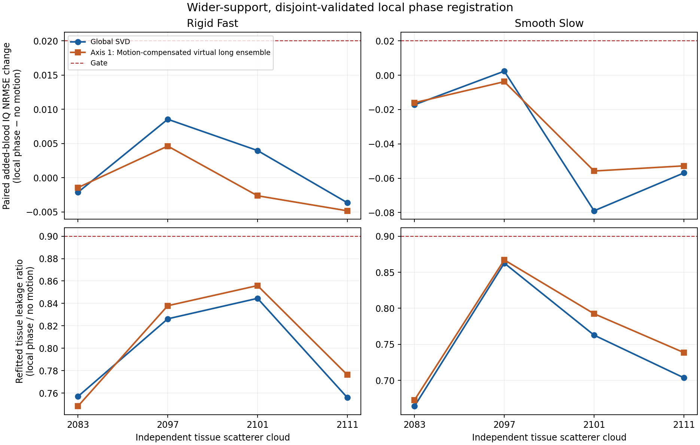

# eSDIva broad-support local phase registration

24 October 2026. The [pre-new-cloud manifest](../configs/esdiva_phase5_design_freeze.json)
fixed the [candidate](../configs/esdiva_phase5_candidate.json), source code,
decision rule and all twelve prior development records before new scatterer
cloud 2111 was acquired. Reserved seeds 2081 and 2093 remain unopened.

The pinned Example 22 RF checkpoints reconstruct a 32-row tissue tile at
14.4–17.5 mm depth. The central eight rows exactly replay the published IQ
score tile, sample for sample. A 5 mm guard around the known tilted vessel
selects 192 tissue pixels; 127 fit the phase field, and 65 disjoint pixels
check each frame and view. Only the measured mixture, stationary disjoint-time
tissue calibration and geometry reach the filter. Isolated blood and tissue
and known scatterer motion are evaluator-only. The fit smooths a normalized
complex tissue-reference cross product at four-pixel scale, unwraps phase
along depth and applies half the phase if its disjoint-pixel improvement is
above 0.01. This is local phase registration, **not** a measured geometric
displacement or spatial resampling. Its unit-magnitude factor keeps the
frozen complex-blood roundtrip exact. Separate mixture and tissue-plus-noise
fits implement the paired source check.

The original eight-row input gate and a fixed wider-ROI gate both require
calibration coherence at least 0.7 and bounded input noise-power gain at most
4. The wider ROI is checked for blood contamination by the evaluator (at most
0.1). Both gates pass all four clouds in every scene; wider ROI
contamination spans 0.0037–0.0203. The full 24-file phase-2 frozen history
and numerical source hash remain intact.

Values below are **local-phase minus no-motion paired added-blood IQ NRMSE /
local-phase divided by no-motion refitted tissue leakage**; the blood change
must be at most +0.020 in all scenes, and the leakage ratio at most 0.900 in
both moving scenes. Both SVD discard 1 and Axis 1: Motion-compensated virtual
long ensemble must pass. All four clouds meet these development
conditions:

| Seed | Rigid SVD | Rigid Axis 1 | Smooth slow SVD | Smooth slow Axis 1 |
|---:|---:|---:|---:|---:|
| 2083 | −0.002 / 0.757 | −0.001 / 0.748 | −0.017 / 0.664 | −0.016 / 0.673 |
| 2097 | +0.009 / 0.826 | +0.005 / 0.838 | +0.002 / 0.863 | −0.004 / 0.867 |
| 2101 | +0.004 / 0.845 | −0.003 / 0.856 | −0.079 / 0.763 | −0.056 / 0.792 |
| **2111, new cloud** | **−0.004 / 0.756** | **−0.005 / 0.776** | **−0.057 / 0.704** | **−0.053 / 0.739** |

Stationary and moving zero-flow controls also meet the blood-increase bound;
paired roundtrip NRMSE is numerically zero in every scene. The separate slow
Axis 2: Motion-demodulated multi-lag separation rank-4, gain-cap-0.40
setting meets its existing ≤0.700 blood NRMSE and ≤0.180 leakage bounds on
all four clouds. Global SVD, Baranger SSM, Stephen Lee AER and
Axis 3: Local ultrasound STAP retain their phase-4 control settings. The
local-phase experiment does not claim to solve the slow or zero-flow
identifiability problem.

## Prospective cloud 2111 and decision

All four new acquisitions pass original and wider calibration gates. The
wide-ROI evaluator-only blood/tissue power ratio is 0.010–0.016. All four RF
replays reproduce the previously used eight-row IQ arrays exactly, including
the separate tissue and blood sources. Both paired roundtrips have NRMSE
between 1.8×10⁻¹⁶ and 3.4×10⁻¹⁶. The stationary blood-NRMSE changes are
−0.0003 for SVD and −0.0002 for Axis 1; the zero-flow changes are −0.0593
and −0.0522. These controls pass the ≤+0.020 damage rule without implying
zero-flow source identifiability.

On new-cloud smooth slow flow, capped Axis 2 yields **0.629 / 0.169**
(paired added-blood NRMSE / refitted tissue leakage), passing both bounds.
For comparison, uncapped Axis 2 gives 0.260 / 0.479, Baranger SSM gives
1.000 / 0.026, and Stephen Lee AER gives 0.963 / 0.028. Local phase improves
SVD from 1.268 / 0.213 to **1.211 / 0.150** and Axis 1 from 1.183 / 0.162
to **1.130 / 0.120**. These absolute SVD/Axis 1 blood errors are large even
though their *changes* and background leakage meet the motion gate. Strong
clutter rejection alone does not establish slow-blood preservation.

The [unchanged decision program](../examples/esdiva_phase5_decide.py) reports
**pass, zero failures** over 16 scene records and 32 motion-method comparisons;
its [machine-readable result](../runs/esdiva_phase5_development/decision.json)
and [source/results freeze](../configs/esdiva_phase5_freeze.json) seal the
candidate before the reserve is used. The frozen phase-2 numerical source hash
is unchanged; seed 2111 did not influence a setting or threshold.

This is a software RF simulation with four independent 10%-density scatterer
clouds and only 16 scored frames per scene. The disjoint spatial check still
samples correlated ultrasound speckle. It does not provide a physical motion
reference, proven preservation of all slow-flow blood, or phantom/in vivo
validation. Reserved seeds 2081 and 2093 remain unopened for the next fixed
comparison.
