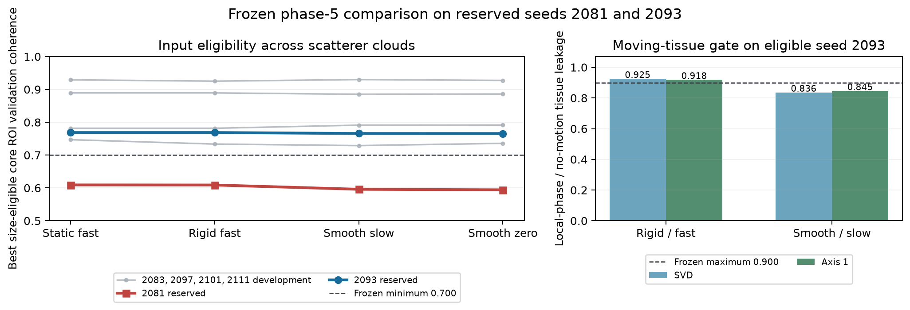

# eSDIva phase-5 reserved-bank comparison

25 October 2026. **Frozen decision: fail.** The [locked eight-scene
decision](../runs/esdiva_phase5_heldout/decision.json) reports six failures:
all four seed 2081 scenes fail original-tile input eligibility before filtering,
and the SVD and Axis 1 rigid-motion tissue leakage ratios on seed 2093 exceed
the fixed 0.900 maximum. There was no replacement seed, threshold change, or
filter retuning after opening either reserve. This candidate is **not cleared
for a physical phantom validation claim**.

The [reserved protocol](ESDIVA_PHASE5_HELDOUT_PROTOCOL.md) and its source
manifest were published before acquiring either reserved seed. The complete
66-file development freeze, numerical source SHA256
`8587a156b3283238920777e96cd059d72203d5a9638a61f5cc43876324cd4e13`,
and pinned Example 22 simulator commit
`ab7eaef6d23428762ab5b9079ab03a5aa99af085` remained fixed. Each
source-resolved RF report, wider-IQ reconstruction audit, and score is in
[`runs/esdiva_phase5_heldout`](../runs/esdiva_phase5_heldout). The audit
verifies separate tissue/blood RF hashes, replayed noise, and the original
eight-row IQ tile; the reviewer verifies the saved report, score, config,
script, and reconstruction hashes. Large regenerable RF and IQ arrays are
not committed.

## Input eligibility on both reserved clouds

The original eight-row core gate requires at least 40 tissue ROI pixels and
calibration coherence at least **0.700**. The displayed core value is the
highest validation coherence among candidates with at least 40 pixels; an
eligible ROI must also satisfy the training and bounded-noise criteria.
The wider gate separately requires coherence at least **0.700**.

| Seed | Scene | Best core validation coherence | Selected core ROI | Wider validation coherence | Wider gate |
|---:|:--|---:|:--|---:|:--|
| 2081 | Stationary fast | 0.60914 | none | 0.70105 | pass |
| 2081 | Rigid fast | 0.60891 | none | 0.70092 | pass |
| 2081 | Smooth slow | 0.59582 | none | 0.69961 | fail |
| 2081 | Smooth zero | 0.59421 | none | 0.70212 | pass |
| 2093 | Stationary fast | 0.76858 | wide both | 0.76660 | pass |
| 2093 | Rigid fast | 0.76863 | wide both | 0.76664 | pass |
| 2093 | Smooth slow | 0.76576 | wide both | 0.76469 | pass |
| 2093 | Smooth zero | 0.76557 | wide both | 0.76469 | pass |

The four development seeds 2083, 2097, 2101, and 2111 had passed this gate;
seed 2081 is a new speckle-cloud generalization failure. Its source and
reconstruction audits completed, but the locked scorer intentionally emits
**no filter metrics** when the input gate fails. Wider-ROI evaluator-only
blood/tissue power is 0.0092–0.0104 on seed 2081 and 0.0071–0.0080 on seed
2093, below the fixed contamination maximum 0.100.

## Paired response on eligible seed 2093

The entries are local-phase minus no-motion *paired added-blood IQ NRMSE* and
local-phase divided by no-motion *refitted tissue leakage*. The blood change
must be ≤+0.020 in all scenes; leakage must be ≤0.900 for rigid fast and smooth
slow. Axis 1 is **Motion-compensated virtual long ensemble**.

| Scene | SVD blood change / leakage ratio | Axis 1 blood change / leakage ratio | Fixed result |
|:--|:--|:--|:--|
| Stationary fast | −0.00011 / 0.95528 | −0.00004 / 0.97136 | blood criterion passes |
| Rigid fast | −0.00280 / **0.92462** | −0.00356 / **0.91821** | **both leakage criteria fail** |
| Smooth slow | −0.04859 / 0.83559 | −0.03304 / 0.84526 | both pass |
| Smooth zero | −0.02831 / 0.83606 | −0.02431 / 0.84565 | blood criterion passes |

Both no-motion and local-phase paired roundtrips on seed 2093 are at most
3.0×10⁻¹⁶, below the 1×10⁻¹⁰ bound. The separately fixed slow-flow **Axis 2:
Motion-demodulated multi-lag separation** rank-4/cap-0.40 point gives paired
blood NRMSE **0.56980** and refitted leakage **0.15959**, passing its 0.700
and 0.180 bounds on this cloud. Baranger SSM, Stephen Lee AER, and **Axis 3:
Local ultrasound STAP** remain in the complete seed 2093 control scores; no
new method was selected post hoc. Passing some scene metrics does not rescue
the all-scene gate, and the zero-flow control does not prove slow-blood
identifiability.

## Execution amendment and physical handoff

After the first seed 2081 RF capture, the runner compared an in-memory tuple
of transmit views with the equivalent saved JSON list. The [published
serialization amendment](https://github.com/hacheleroy/blood-tissue-separation-ultrasound/commit/f40391b52ca23869df046589a7450cb72dc90c95)
checks the saved acquisition report and permits replay of complete RF without
reacquisition. Seed 2081 stationary and rigid RF were resumed. This changed
only orchestration and the adapter manifest hashes, not the frozen numerical
source, score, decision, candidate, or thresholds. The other six scenes used
the amended runner directly.

The [physical phantom v07 protocol](PHANTOM_PROTOCOL_V07.md) verifies as
frozen, and its scaffold declares 180 capture slots across independent
development and held-out sessions. Its preflight correctly rejects the
incomplete acquisition card. There are currently **no measured phantom RF
captures or independent motion and flow references**, so no physical result
can be computed. The v07 analysis was frozen for a v06 8×16 candidate; this
phase-5 local-phase experiment uses a 32-row registration input and an
eight-row score tile. Transferring phase 5 to physical data would require a
separately preregistered geometry and analysis bridge before acquiring a new
physical held-out session.

Next, investigate calibration robustness and rigid-motion tissue leakage on
**newly declared development clouds**, without fitting to reserved seeds 2081
or 2093. Freeze any revised candidate and a fresh reserve before confirmation.
In parallel, obtain the scanner geometry, independent optical/DIC motion and
flowmeter/PIV references, masks, and paired pump-on/off captures needed by the
physical protocol. The reserved failures remain visible in this report.
