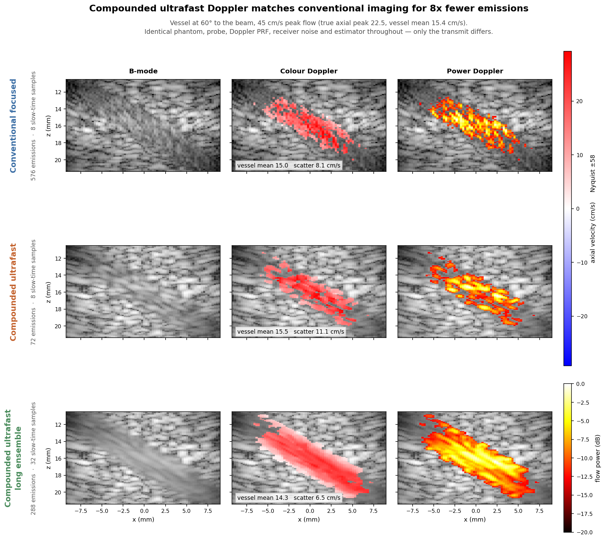
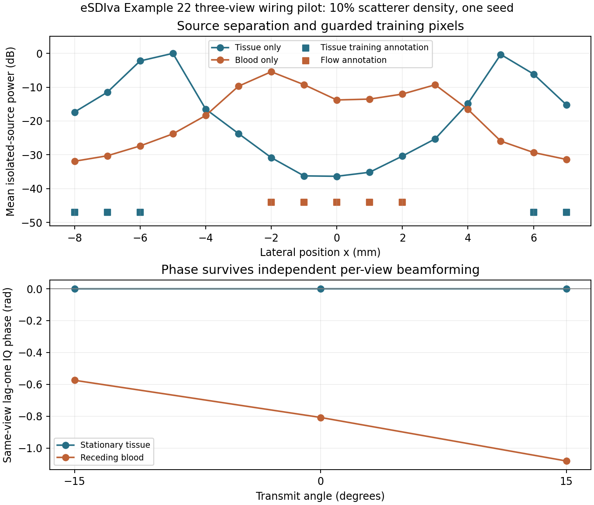

# eSDIva Example 22: upstream reproduction and three-view pilot

24 October 2026. Upstream eSDIva v0.3.0 at commit
[`ab7eaef`](https://github.com/EstebanRivera08/eSDIva/tree/ab7eaef6d23428762ab5b9079ab03a5aa99af085/examples/example22_flow_doppler).
This is an acoustic simulation of particle scattering, not an experimental
phantom acquisition. The [benchmark design](ESDIVA_RF_BENCHMARK_PROPOSAL.md)
explains the longer, moving-tissue and held-out study needed for a filter claim.

## Upstream three-arm example

The original `step2_acquire_RF.py`, `step3_doppler_processing.py`, and
`step4_visualize.py` ran without source edits. The compact
[checksum and Doppler manifest](../runs/esdiva_pilot_v08/upstream_reproduction.json)
records every RF event's verified SHA-256, channel time origins, sample periods,
received carrier, and the upstream's asserted Doppler metrics. The upstream
`step4_visualize.py` ran with a noninteractive backend to produce its figures.

All **936 channel RF events** passed their recorded per-event SHA-256 checks.
The upstream Doppler assertions passed for direction, known-velocity range,
A/B agreement and C's lower estimate spread. The known vessel mean is
15.44 cm/s (axial peak 22.5 cm/s):

| Upstream arm | Emissions | Echo carrier (MHz) | Vessel mean (cm/s) | Spatial spread (cm/s) | Flow detected |
|:--|--:|--:|--:|--:|--:|
| A: focused | 576 | 2.600 | 15.03 | 8.05 | 70% |
| B: nine-angle compound | 72 | 2.471 | 15.48 | 11.11 | 64% |
| C: longer compound | 288 | 2.470 | 14.29 | 6.50 | 75% |

B's vessel mean differs from A by 0.45 cm/s, or 2.9% of the known mean,
using one eighth as many emissions. C's spread is 6.50 against B's 11.11
cm/s, with four times the slow-time frames. This is the upstream example's
wall-filter and Doppler estimator on **full-density** simulated RF.



Figure generated by eSDIva Example 22 at the pinned commit (BSD-3-Clause);
its exact output SHA-256 is in the manifest.

The upstream nine-angle B/C frames are coherently compounded. They have no
three-view IQ or isolated blood/tissue IQ. Also, C spends **288 emissions**
against A's **576**: some upstream prose calls this a matched emission budget,
but the executable plan and event counts do not. Its Doppler checks validate
the upstream example's own fast flow, not native-blood filter accuracy.

## Separate, source-resolved three-view pilot

The optional [RF-to-IQ adapter](../examples/esdiva_example22_pilot.py) reuses
the pinned phantom and simulator but fires -15°, 0°, +15° plane waves once per
frame. Each emission has its own `t0_per_event`, event-specific DAS volume, and
one view of complex IQ. A measured **2.564 MHz** carrier is fixed from a
disjoint tissue-only calibration. The same 6 dB receiver noise scale is used
over the 16 calibration and 32 evaluation frames. Tissue-only and blood-only
simulations have identical scatterer positions and events; only source
amplitudes differ. The source components stay outside `PublicInput` and enter
only evaluator diagnostics.

To make the initial wiring run affordable, this pilot keeps a deterministic
**10% subset** of upstream particles: 456 tissue and 618 blood, seed 2027 for
the subset and upstream phantom seed 2026. This reduces speckle density and is
not the full-density Example 22. An initial narrow tile incorrectly placed
vessel signal in the tissue training area; the reported pilot uses a wider
16-column tile and outer `|x| >= 6 mm` training annotation. The isolated blood
to tissue power ratio in this region is **0.00553**, while the central flow
annotation has a ratio **219**. These truth-based ratios check the annotation;
they do not train any filter.

| Pilot check | Result |
|:--|--:|
| RF: isolated tissue + blood versus independent combined event, relative error | 1.43 × 10⁻⁷ |
| Beamformed isolated sum versus combined RF beamform, relative error | 4.80 × 10⁻⁸ |
| Demodulated isolated sum versus combined beamform IQ, relative error | 1.71 × 10⁻⁷ |
| Shared input shape / scored frames after a 16-frame history | 32 × 3 × 8 × 16 / 16 |
| Tissue same-view lag-one phases, -15° / 0° / +15° | -0.000063 / +0.000061 / -0.000057 rad |
| Blood same-view lag-one phases, -15° / 0° / +15° | -0.574 / -0.807 / -1.081 rad |

Repeating reconstruction and scoring from the same RF checkpoints produced
an exactly identical JSON report; this checks deterministic processing, not an
independent particle draw.



All seven configured methods, including the three axes and Stephen Lee's
temporal AER, accepted the same IQ layout and returned finite output. This is
a **plumbing check**, not a ranking: one stationary-tissue, fast-flow scene,
one short history, an intentionally sparse particle cloud and only 16 scored
frames. The third view's tissue calibration gain was only about 0.042 relative
to view one, so a single complex-gain steering model is poorly supported at
these angles. The loaded STAP pilot's frozen isolated-blood power was 28.6×
input power; this is a calibration and noise-gain warning, not evidence of
blood preservation. AER reduced frozen tissue power to 0.00029× but also
reduced frozen blood power to 0.036×; low tissue leakage by itself is not a
successful separation. The [full pilot record](../runs/esdiva_pilot_v08/report.json)
contains every exploratory setting and diagnostic.

## Reproduction

Use Python 3.12 and the package versions in the two JSON manifests. Clone
eSDIva at the exact commit above and install it in an isolated environment.
From its root, run `step2_acquire_RF.py`, `step3_doppler_processing.py`, and
`step4_visualize.py` in that order, the last with `MPLBACKEND=Agg` and
`ESDIVA_SAVE_FIG=1`. The full upstream acquisition is slow and writes
per-event RF checkpoints. Audit the results from this repository:

```bash
python examples/audit_esdiva_example22.py --upstream-root /path/to/eSDIva \
  --output /path/to/upstream_reproduction.json
python examples/esdiva_example22_pilot.py --upstream-root /path/to/eSDIva \
  --output /path/to/new/pilot
python examples/plot_esdiva_pilot.py --pilot /path/to/new/pilot \
  --output /path/to/figure.png
```

The upstream figure step writes two image files into its documentation
directory. The audit permits exactly these changed tracked images and checks
their hashes; the source files must still match the pinned commit.

The raw RF and IQ products remain outside Git. The pilot JSON contains their
content hashes, geometry, package versions and numerical source fingerprint.
No experimental phantom, motion-compensation validation, full-density
separation comparison or held-out seed test has been completed here.
