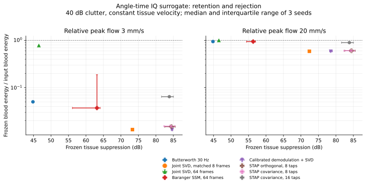
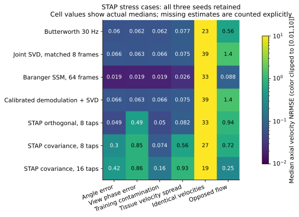

# First benchmark findings

Historical initial results. Current source-fidelity measurements and executed studies are in [SEPARATION_FIDELITY.md](SEPARATION_FIDELITY.md) and [VALIDATION.md](VALIDATION.md).

The verified study contains 24 statistical-IQ SVD/EVD cases and 42 angular-IQ
STAP cases. Parameters were frozen before execution. The source audit separates
equation-level implementations, method-family variants and provisional arms.
No experimental or acoustic benchmark was performed.

## Axis 3: rejection and preservation must be measured together

The following are medians across three seeds, at 40 dB clutter and constant
tissue velocity. Suppression is -10 log10 of the frozen tissue-power retention.
Each operator is fitted once to the mixture before evaluating its components.

| Relative peak flow | Method | Blood energy retained | Tissue suppression | Axial velocity NRMSE |
|---|---|---:|---:|---:|
| 3 mm/s | Baranger SSM, 64 frames | 3.71% | 63.1 dB | 0.428 |
| 3 mm/s | Orthogonal STAP, 8 taps | 1.49% | 84.5 dB | 1.69 |
| 3 mm/s | Covariance STAP, 16 taps | 6.44% | 83.8 dB | 0.522 |
| 20 mm/s | Baranger SSM, 64 frames | 94.5% | 56.3 dB | 0.0255 |
| 20 mm/s | Orthogonal STAP, 8 taps | 60.4% | 84.5 dB | 0.0501 |
| 20 mm/s | Covariance STAP, 16 taps | 89.9% | 83.8 dB | 0.0265 |

Short STAP snapshots can remove most slow blood along with tissue. Extending
the snapshot improves preservation in these cases. Stronger clutter rejection
alone is therefore insufficient evidence for better velocity or WSS. The
64-frame SSM arm has longer observation support; matched short-window SVD,
per-view SVD and calibrated-demodulated SVD are also retained in the records.

## Calibration and identifiability

Unknown view phase and tissue velocity spread degrade the current covariance
STAP prototype. Diagonal loading and clean spatial training do not resolve a
wrong steering model. The training-starved arm records its orthogonal fallbacks.

When coherent blood and tissue have the same velocity/steering, both are
suppressed. This negative control exposes the identifiability limit of the
operator. Its residual/noise velocity estimate must not be interpreted as a
recovered blood velocity. The LCMV detector separately rejects overlapping
constraints; its output is a fixed-grid detector at one target, with no WSS.

## Literature comparison

The full SSM square fit now has tested lower and upper boundaries. Randomized
SVD and Gram EVD preserve the expected algebra under their exactness controls.
Butterworth cutoffs expose the expected slow-flow / clutter tradeoff. The
frozen Huang thresholds and Song-style reconstruction do not give a universal
improvement on this small bank. Their results must be read with their source
fidelity and signal assumptions, especially the provisional Song cutoff rule.
Incoherent PD aggregation is reported separately from the IQ reconstruction
used for velocity and directional WSS.

All per-condition metrics are in the [SVD/EVD aggregate](../runs/svd_literature_v02_verified/results.json)
and [STAP aggregate](../runs/stap_v02_verified/results.json). [Validation](VALIDATION.md)
records software identities, invalid-estimate treatment and numerical limits.
