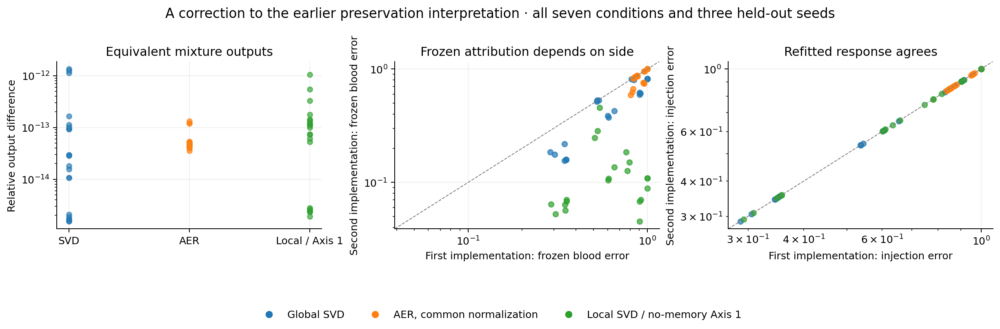
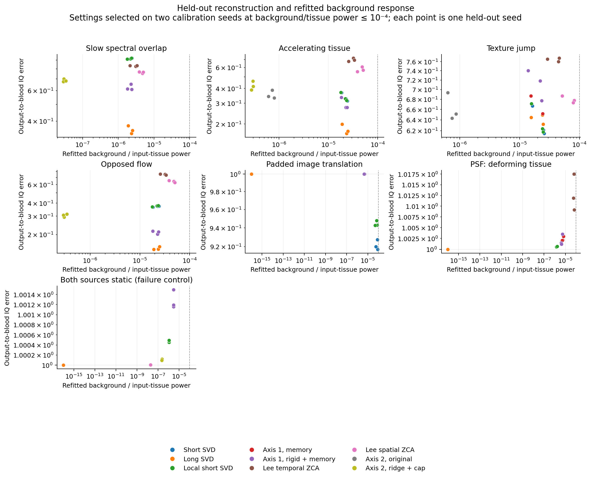
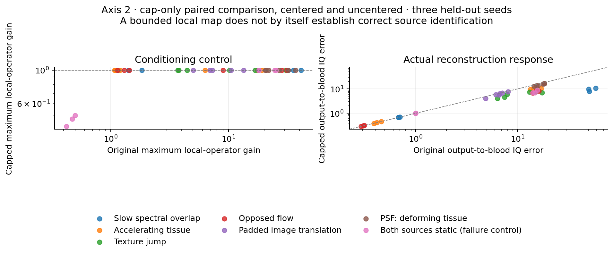
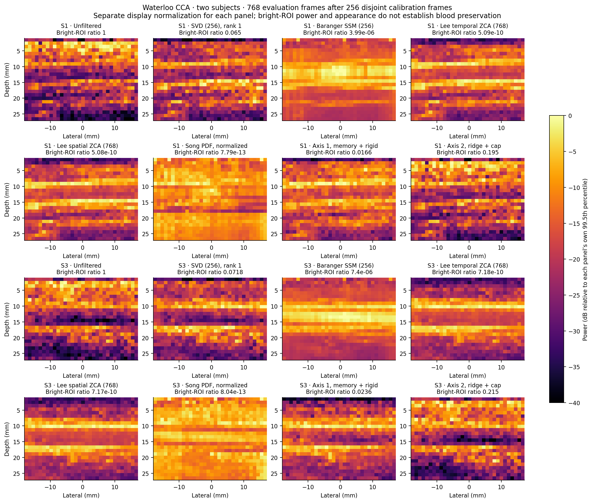

# PDF-audited follow-up results, v0.3.0

23 October 2026. All three requested follow-ups are executed: Axis 1 ablations
against short/long/local SVD, conditioning controls for Axis 2, and a longer
Waterloo pilot on two subjects. Stephen A. Lee et al.'s temporal and streamed
spatial AER algorithms are included. All 3,850 synthetic and 58 experimental
method/case records returned successfully. Execution alone does not establish
source separation or an iterative solver's convergence.

## Correction to the earlier interpretation

The earlier frozen-component comparison overstated the evidence for Axis 1's
blood preservation. An adaptive SVD output can be written as a left or right
projection, yet those fitted operators act differently on an isolated blood
component. Equivalent mixture outputs agree within 1.36e-12 relative error in
the new controls, while the normalized difference between their frozen blood
outputs reaches 0.996. Common-normalization AER has the same issue. Such an
attribution is conditional on the chosen representation.



The primary error is now the actual output error `||F(X)-B||/||B||`, without
truth-fitted amplitude or phase correction. Background response refits on
`T+N` and divides its output power by input tissue power. This is not measured
tissue leakage within `F(X)`. Refitted blood-injection responses at amplitudes
0.1 and 1 describe incremental adaptive behavior, not additive attribution.

## 1. Axis 1: Motion-compensated virtual long ensemble

Two calibration seeds select one setting per family and condition; three
different seeds evaluate it. A candidate must meet the background/tissue power
target on both calibration seeds, then have the lowest mean calibration output
IQ error. This uses simulated source truth only on calibration cases and is
not a deployable data-only selector. The figure shows target 1e-4; archives
also retain 1e-2 and 1e-6, infeasibility and held-out target checks.



Selected held-out median IQ errors at calibration target 1e-4, three seeds per
cell (lower is better; zero output has error 1):

| Condition | Short SVD | Long SVD | Axis 1 memory | Lee temporal ZCA | Lee spatial ZCA |
|---|---:|---:|---:|---:|---:|
| Slow spectral overlap | 0.915 | 0.353 | 0.614 | 0.837 | 0.766 |
| Accelerating tissue | 0.326 | 0.174 | 0.276 | 0.694 | 0.572 |
| Texture jump | 0.621 | 0.645 | 0.678 | 0.766 | 0.678 |
| Opposed flow | 0.373 | 0.145 | 0.213 | 0.753 | 0.645 |
| Padded image translation | 0.920 | 1.000 | infeasible | infeasible | infeasible |
| Deforming PSF tissue | 1.000 | 1.000 | 1.002 | 1.012 | infeasible |
| Both sources static, failure control | 1.000 | 1.000 | 1.001 | 1.000 | 1.000 |

Every selected point above meets the held-out background target on all three
seeds. Infeasible means no setting passed both calibration seeds. Passing that
target alone is insufficient: zero output passes while losing all blood.

Memory improves over short/local SVD in slow overlap, acceleration and opposed
flow, but long SVD has lower error in those cases. Texture change reverses the
advantage. Rigid registration gives no consistent rescue; its selected
translated-case error is about 1.000. No-memory Axis 1 equals local SVD at
matching support. Without centering, global phase demodulation/restoration
cancels in spatial covariance and cannot by itself improve output. Deformation
and equal-static sources remain failure cases.

Lee AER uses pixel-wise temporal centering, regularized ZCA, temporal covariance
divided by pixel count and streamed spatial covariance divided by T-1. Its
input-unit regularizers 1, 26 and 1000 are separate from relative-regularization
and unit-operator extensions. Whitening changes amplitude: raw errors assess
direct blood-IQ reconstruction, not localization/tracking after amplitude
normalization. This is not a replication of Lee's contrast-enhanced transcranial
animal ULM experiment, long ensembles or trajectory counts. Negative Doppler
bins are not labeled noise solely because their FFT index exceeds PRF/2.

## 2. Axis 2: Motion-demodulated multi-lag separation

The grid varies rank selection, ridge whitening, centering and a local
operator-gain cap. Across 42 paired held-out cap-only comparisons, the largest
original local gain is 41.18; the cap limits it to 1 within floating-point
precision. Large uncentered reconstruction errors decrease but remain large
in difficult cases. Some centered cases get slightly worse. Capping controls
conditioning; it does not solve source identification.



At target 1e-4, the ridge-plus-cap family has median errors 0.682, 0.416 and
0.307 in slow overlap, acceleration and opposed flow, versus 0.680, 0.342 and
0.305 for original Axis 2. The guarded family is infeasible in texture-jump,
translation and deforming-PSF cases. More regularization is not a universal
improvement. Original/capped gain, whitening condition/residual, lag signatures
and component decisions are archived. The cap bounds a local frozen map, not
the full adaptive, centered or motion-compensated pipeline.

## 3. Longer experimental pilot

Waterloo CCA Acq0 (subject 1) and Acq12 (subject 3) each supply 1,024 frames.
The first 256 calibrate a nuisance ROI and bulk motion; the next 768 evaluate
29 fixed methods. This is 24 times the previous evaluation length, but only
0.256 seconds per subject at 3 kHz. Within-recording calibration and evaluation
remain physiologically correlated. Two subjects do not establish population
validation. Both uncompounded views and absolute event timing are retained.



Each display is normalized to its own 99.5th power percentile to show structure.
Brightness and bright-calibration-ROI power ratios do not measure blood
preservation. AER and Song normalization change output units: their small power
ratios cannot establish superior rejection. No experimental oracle, source
truth, verified contrast status or independent phase/velocity reference exists.

Uncentered original Axis 2 gain reaches 55.39 and 36.78 in the two acquisitions;
the guarded runs remain at 1. Each source file's aperture/transmit geometry was
checked. RF decoding uses bounded 16-frame batches, and batched/unbatched
reconstruction identity is tested. Numerical geometry fitting differs slightly
from the previous pilot: first-64-frame relative complex-IQ difference 1.17e-5.

Dataset attribution: Hassan Nahas, Jason Y.-H. Hsu, Theresa Gu, Adrian J. Y.
Chee and Alfred C. H. Yu, University of Waterloo LITMUS / Open-H-RF, CC BY 4.0.
The upstream revision and URLs are pinned in the frozen configuration. This
project performs reconstruction/filtering; raw RF and generated IQ are not
redistributed in Git.

## PDF audit and reproducibility

The supplied full texts resolve the earlier Maresca access gap and correct
Song's reconstruction: log-tail fitting, retained-singular-value-sum block
normalization and coherent averaging are explicit. Song's unspecified detector
tolerances remain implementation choices. The 2023 MATLAB Appendix B validates
the Baranger sum-table objective. The optional MathWorks download required
sign-in; package-execution parity is not claimed. See the [full audit](PDF_METHOD_AUDIT.md)
and [source hashes](PDF_SOURCE_PROVENANCE_V04.json).

The [protocol](FOLLOWUP_PROTOCOL_V04.md), [synthetic summary](../runs/fidelity_followup_v04/SUMMARY.md),
[experimental summary](../runs/openhrf_followup_v04/SUMMARY.md), scripts, PNG/SVG
figures and lossless hashed result parts are versioned. Restore with:

```bash
python scripts/verify_results.py --manifest runs/followup_v04_manifest.json --require-current-code --restore
```

Restored `results.json.xz` files contain the exact frozen JSON bytes; use
`lzma.open(path, 'rt')`. Runners produce ordinary JSON; analysis scripts accept
restored XZ or local GZIP. Numerical source hash:
`b249dda5158ec26f472e4ba36e09b5c7cadd79fc755751646a7b300ea0af160b`.

## Next scientific steps

1. Validate IQ phase/velocity on controlled moving-target or flow-phantom data
   with a documented signed Doppler reference.
2. Add longer independent recordings and more subjects; freeze a data-only
   selector on training acquisitions before final evaluation.
3. Test source identification under nonrigid tissue deformation. Retain long
   SVD and Lee AER as controls; assess AER separately on localization/tracking
   endpoints when suitable contrast data are available.

The evidence supports further study of memory and conditioning. It does not
support general Axis 1/2 superiority or validated quantitative vector-flow/WSS.
