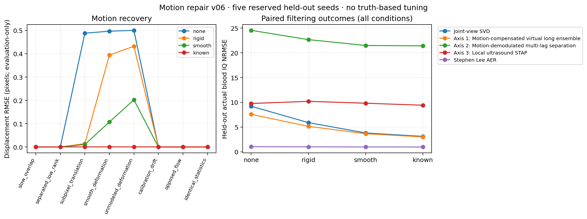

# Motion repair: reserved held-out evaluation

23 October 2026 · package v0.5.0 · numerical source SHA256
`8587a156b3283238920777e96cd059d72203d5a9638a61f5cc43876324cd4e13`.
The [predeclared protocol](MOTION_REPAIR_PROTOCOL_V06.md) fixed source, options,
conditions, 36-setting grid and seed split before any reserved draw. The run
contains 24 development/training cases (601, 787, 919) and 40 held-out cases
(1601, 1907, 2203, 2503, 2801), eight conditions each, with 2,304 method
outputs and three independent refits per setting. Global selection uses only
training cases, although there is only one setting per family and motion arm.
The published numbered archive, CSV, summary and figure are checked by CI.

The original registration failed static controls and gave ~1.24–1.26-pixel
mean error on imposed translation/smooth motion. A discontinuous zero-boundary
sampler and an envelope objective were replaced by continuous zero extension,
complex calibration-reference fitting, exact within-cell derivatives, and
spatially held-out acceptance gates. The scene generator and historical archive
remain unchanged. Separate registration-only complex nuisance gains never
rescale output IQ.

| Condition | No compensation | Gated rigid | Gated smooth | v05 estimated smooth |
|:--|--:|--:|--:|--:|
| Subpixel translation | 0.488 | 0.0147 | **0.0108** | 1.262 |
| Smooth deformation | 0.497 | 0.394 | **0.107** | 1.238 |
| Unmodeled deformation | 0.500 | 0.432 | **0.203** | ~1.25 |
| Five no-warp conditions | 0 | 0 | **0** | static failures in v05 |

Entries are mean displacement RMSE in pixels against the simulator's
prescribed coordinates, an **evaluation-only** diagnostic. In all five
no-warp conditions, the repaired gate accepted zero frames on the actual
mixtures and applied exactly zero displacement. The motion conditions averaged
125.8, 122.2 and 111.6 accepted frames out of 128 under gated smooth fitting,
respectively. Known coordinates are a separate evaluation-only upper control.

| Fixed family / 64-frame setting | No compensation | Gated smooth | Known warp |
|:--|--:|--:|--:|
| Joint-view SVD, cutoff 1 | 9.202 | **3.806** | 3.112 |
| Axis 1: Motion-compensated virtual long ensemble, cutoff 1 | 7.576 | **3.646** | 3.003 |
| Axis 2: Motion-demodulated multi-lag separation, rank 4 | 24.540 | 21.482 | 21.409 |
| Axis 3: Local ultrasound STAP, loaded 0.01 | 9.756 | 9.813 | 9.410 |
| Stephen Lee temporal AER, absolute ε=26 | 1.026 | 0.976 | 0.964 |

Entries are the arithmetic mean over all 40 held-out cases of actual-output
complex-IQ NRMSE against simulated blood. On translation, gated smooth SVD
improves from 23.61 to 7.47, and Axis 1 from 19.24 to 7.23. On smooth
deformation they improve from 23.63 to 9.30 and 19.34 to 8.92. All these
errors remain substantial, including under the known-warp control. The
calibration-drift condition still gives loaded STAP ~36.3 without motion,
and Axis 2 remains high across the bank; registration has not solved either
method's separate model/identification failures.

Actual blood-IQ error is only one side of the comparison. Pooled refitted
background-to-tissue power changes from 0.150 to 0.0244 for SVD and 0.100 to
0.0221 for Axis 1 under gated smooth. The refitted α=1 blood-response NRMSE,
however, changes from 0.387 to 0.447 for SVD and 0.417 to 0.468 for Axis 1:
motion improves clutter/error while attenuating or distorting some incremental
blood response. Lee temporal AER has low background power (~1.03×10⁻⁴ with
gated smooth) but its refitted α=1 blood-response error is ~0.906, so its
near-unit actual-output error must **not** be interpreted as good blood
preservation. Fixed settings here do not establish a general family ranking.

The predeclared software gate **passes**: primitive static/mismatched/flat
controls reject, accepted maps pass geometry checks, both moving-condition
RMSEs beat historical v05, and pooled paired SVD/Axis 1 actual blood error
does not degrade by >5% relative to no compensation. This permits the next
**phantom validation experiment**, not use on patient IQ or a claim that
phantom validation is complete. The next acquisition should independently
measure a stationary tissue-only control, imposed subpixel rigid and
nonrigid motion with known fiducials, and a flowing scatterer channel at
several clutter-to-blood and SNR levels. Freeze the phantom calibration/ROI
and gate before acquisition, evaluate actual blood response and tissue leakage
alongside displacement/roundtrip errors, and compare the same SVD, weighted
SVD/Axis 1, Axis 2, STAP and Lee AER settings under matched input/support.
In particular, prioritize Axis 2 identification and STAP steering drift as
separate follow-up work rather than attributing their errors to registration.

All data here are synthetic statistical angular IQ with imposed image warps,
not channel RF, acoustic scatterer truth or experimental phantom data. The
calibration shares a tissue texture with the scored scene. Spatial validation
pixels are disjoint from fitting pixels but use the same frame and scene;
the reserved seeds provide independent synthetic draws, not a new domain.
