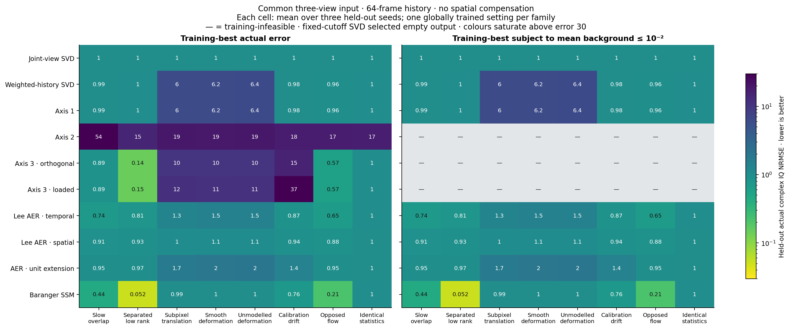
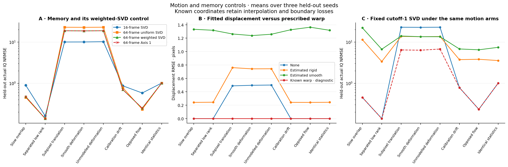
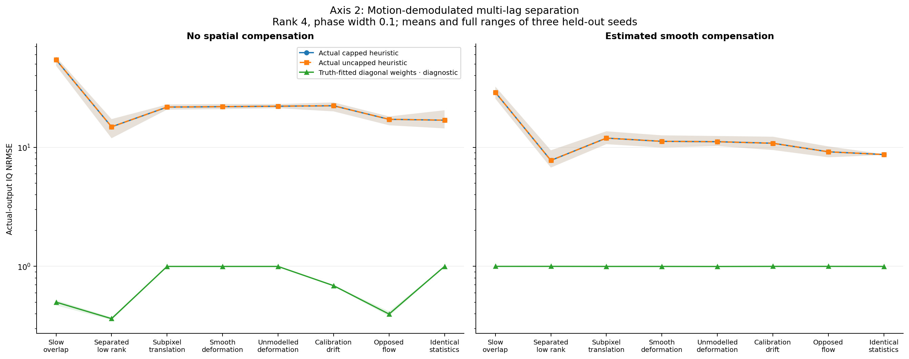
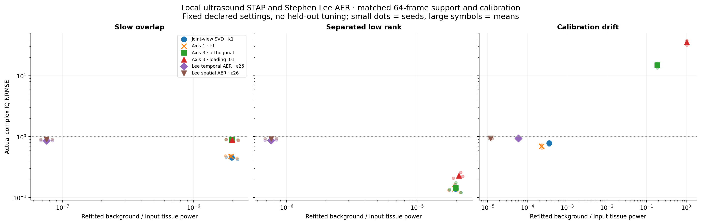

# Shared three-axis benchmark: executed results

23 October 2026 · package v0.4.0 · study v05.

The shared comparison is complete: **40 synthetic cases × 73 settings = 2,920
case-setting evaluations**, with 8,760 independently fitted outputs including
background and weak-blood counterfactuals. All returned successfully. Sixteen
cases train the global operating points; 24 cases evaluate them on new seeds.
All arms retain the same three views, calibration packet, 8×16 tile and scored
frames [64,128), with declared 16/64-frame history and 16-frame packet latency.

The present prototypes do **not** show a reliable advantage over the tested SVD
and AER baselines. The benchmark exposes an algebraic memory equivalence, a
failed motion estimator, an identification failure and a calibration-sensitive
STAP null. These are statistical angular-IQ software results. The tissue texture
is shared with calibration, as is the blood spatial texture in the low-rank and
identical-statistics cases; acoustic realism and experimental transfer are not
established. The [frozen protocol](SHARED_BENCHMARK_PROTOCOL_V05.md) gives the
information contract, assumptions, conditions, split and exact measurements.

## Globally trained operating points

Each family selects one setting across **all** training conditions, grouped by
motion arm and history. Held-out truth never changes that setting. The table
shows the unconstrained training-best recipe at 64-frame history without spatial
compensation. Errors and background powers are arithmetic means over 24 held-out
cases. No fitted truth-based gain/phase correction is applied.

| Family | Selected setting | Actual IQ NRMSE | Refitted background / tissue power | Weak incremental NRMSE, α=0.1 |
|---|---|---:|---:|---:|
| Baranger SSM | Adaptive two-boundary band | 0.682 | 3.87e-6 | 0.935 |
| Lee spatial AER | Absolute ε=26 | 0.973 | 4.62e-5 | 0.905 |
| Fixed-cutoff joint-view SVD | **Empty-output endpoint** | 1.000 | 0 | 1.000 |
| Lee temporal AER | Absolute ε=1 | 1.041 | 3.51e-4 | 0.637 |
| Weighted-history SVD | Cutoff 4, ρ=0.75 | 2.931 | 1.06e-2 | 0.994 |
| Axis 1 | Cutoff 4, ρ=0.75 | 2.931 | 1.06e-2 | 0.994 |
| Axis 3, orthogonal | Nominal calibrated tissue null | 6.095 | 5.30e-2 | 0.642 |
| Axis 3, loaded | Loading 0.1 | 9.221 | 1.78e-1 | 0.669 |
| Axis 2 | Rank 4, phase width 0.3 | 22.249 | 2.56e-1 | 0.607 |

This is a comparison of the **declared candidates**, not a claim of optimal
SVD tuning or general Baranger superiority. The fixed SVD grid is deliberately
small (cutoffs 1, 4, a centred cutoff-1 arm and empty output); its global training
objective selects zero rather than tolerating large motion failures. Baranger
adapts its band to each packet. On held-out moving cases its lower cutoff ranges
from 9 to 17, beyond the nonempty fixed-SVD candidates. In a replay, all 80
none/smooth actual Baranger outputs reproduced the archived errors exactly;
all 320 bands are listed in the [band ledger](../runs/shared_axes_v05/baranger_bands.csv).



Left: unconstrained training-best actual error. Right: training-best under mean
background ≤10⁻². Each cell averages three held-out seeds for that condition.
Grey means infeasible on training. Colour saturates above error 30; annotations
retain the values. “Axis 1/2/3” denote the canonical research names below.

There are 96 recipes including unconstrained settings; **41 of 64 constrained
recipes are infeasible on training**. At target 10⁻², unregistered Axis 1/weighted
SVD selects cutoff 4 but only 15/24 held-out cases meet the target, and their
held-out mean background 0.0106 also exceeds it. Axis 2 and both STAP families
are infeasible at that target. Baranger passes 24/24 held-out cases at 10⁻².

The stricter 10⁻⁴ target remains infeasible for Baranger on training: its mean
is 1.0303e-4, driven by one smooth-deformation training case at 1.5869e-3.
Its favourable held-out background does not override that frozen decision.
At the same target, the selected spatial AER passes 17/24 held-out cases, and
the selected temporal AER passes 15/24. A mean training constraint is not a
per-case guarantee. See [all selected settings and pass fractions](../runs/shared_axes_v05/operating_points.csv).

## Axis 1: Motion-compensated virtual long ensemble

The expiring moment implementation and direct weighted SVD give the same
primary measurements to a maximum absolute discrepancy of **2.85e-11** across
all paired cases/settings. Tests also compare their complex outputs directly,
with centred/uncentred means and with/without history. Memory here changes the
observation weighting; it does not introduce a separate separation principle.

At fixed cutoff 1 with no spatial compensation, longer uniform history improves
slow-overlap error from 0.893 (16 frames) to 0.454 (64 frames), and opposed-flow
error from 0.582 to 0.234. Axis 1/weighted history gives 0.475 and 0.249,
respectively. In moving scenes, unregistered 64-frame SVD instead has error
22.8–22.9 versus 10.0–10.2 for 16 frames. More history is not uniformly helpful.



The registration arm **fails a necessary static-scene control**. In scenes with
zero prescribed displacement, estimated smooth displacement RMSE is about
1.32–1.36 pixels, and rigid estimation is about 0.24 pixels. On the three moving
conditions smooth RMSE is about 1.24–1.26 pixels, worse than leaving the imposed
field uncorrected (about 0.49–0.50). This estimator should not be recommended for
real-data use. Its effect is also applied to every matched baseline, rather than
credited as an Axis 1 benefit.

Known coordinates improve cutoff-1 error on the three moving conditions to
6.35–6.77, but do not make it accurate. Complex interpolation, finite boundary
loss and background model mismatch remain even with zero coordinate error.
Round-trip controls retain those losses. Coordinate recovery and IQ recovery
must be validated separately; no truth mask hides boundary errors.

## Axis 2: Motion-demodulated multi-lag separation

The cap bounds each fitted spatial operator's spectral norm at 1. It does not
ensure source identification, tissue suppression or stability of refitting.
For the fixed rank-4, phase-width-0.1 unregistered arm:

| Held-out condition | Actual capped heuristic error | Truth-fitted diagonal-weight error in uncapped basis |
|---|---:|---:|
| Slow overlap | 54.329 | 0.501 |
| Separated low rank | 14.849 | 0.364 |
| Subpixel translation | 21.753 | 0.999 |
| Smooth deformation | 21.932 | 0.999 |
| Unmodelled deformation | 22.129 | 0.999 |
| Calibration drift | 22.325 | 0.689 |
| Opposed flow | 17.172 | 0.398 |
| Identical statistics | 16.887 | 0.999 |



The diagnostic fits real component weights in [0,1] to blood truth **after** the
mixture basis has been fitted. It is excluded from selection. It shows room for
better identification in several static scenes, while the moving-scene basis
itself provides little useful blood reconstruction through diagonal reweighting.
It is not an upper bound on every capped operator or proof of physical
identifiability. Shading shows the full range of three held-out seeds.

AJD reaches its iteration limit in **1,095 of 5,280 packet fits** (20.7%), counting
all actual/background/weak-injection fits. These outputs remain labelled and
included, rather than removed to improve a score. Their stopping flags,
off-diagonal residuals and lag-signature separation are in the archive.

## Axis 3: Local ultrasound STAP, and Stephen Lee AER

All methods receive the same calibration and uncompounded views. A 16×3 STAP
snapshot has dimension 48; minimum guarded training counts are 39 for short
history (K/d=0.8125) and 156 for long history (K/d=3.25). These columns are
correlated and do not constitute that many independent samples. Loading and
fallback diagnostics remain explicit.



At fixed settings without spatial registration, orthogonal STAP has error 0.145
in the separated low-rank condition, versus 0.139 for 64-frame cutoff-1 SVD.
For slow overlap it has 0.888 versus SVD's 0.454. In the calibration-drift case,
STAP errors rise to 14.959 (orthogonal) and 35.255 (loading 0.01), versus SVD's
0.785. Covariance adaptation does not repair an incorrect nominal tissue
steering vector in these tests. The present STAP arm has no robust advantage.

Lee's temporal and spatial ZCA covariance algorithms are explicitly included,
with their audited denominators, absolute/relative regularisers and a labelled
unit-gain extension. At absolute ε=26, temporal AER's slow-overlap error is
0.863 and spatial AER's is 0.906. Their low background powers also accompany
substantial amplitude attenuation; a dark output alone is not preservation.
The figure holds ε=26 fixed; the global table separately reports training-selected
ε. These IQ units and endpoints differ from Lee's contrast-enhanced ULM
experiment, which is not replicated here. See the [PDF method audit](PDF_METHOD_AUDIT.md).

## What these results support next

1. Repair and gate registration using development data and static/no-motion
   controls, then freeze a new study with fresh evaluation seeds. Start with
   boundary-aware, well-conditioned rigid/subpixel estimation; reject an
   unreliable warp. Validate complex round-trip loss separately before adding
   a more flexible deformation model. The present held-out bank is now seen.
2. Train and validate component identification in cases where Axis 2's basis
   diagnostic is useful. Cases near error 1 even with truth-fitted weights need
   a better representation or richer observations, rather than threshold tuning.
   Treat AJD stopping failures as a development issue to resolve explicitly.
3. Add calibration uncertainty and multiple tissue steering modes to the STAP
   development tests, retaining joint-view adaptive SVD/Baranger and Lee AER
   controls. Extend fixed-SVD cutoffs on training data before any new final
   comparison. Freeze preservation requirements as well as background rejection
   so an empty output cannot masquerade as a useful operating point.

After those software gates, validate signed IQ phase and motion on calibrated
bubble-free phantom/RF data, then independent longer in-vivo acquisitions.
Do not infer quantitative vector flow, WSS or ULM performance from this bank.

## Reproducibility

The [frozen configuration](../runs/shared_axes_v05/frozen_config.json),
[method ledger](../runs/shared_axes_v05/method_ledger.csv),
[condition CSVs](../runs/shared_axes_v05/metrics),
[summary](../runs/shared_axes_v05/SUMMARY.md) and
[manifest](../runs/shared_v05_manifest.json) accompany all four PNG/SVG figures.
The full 14,902,136-byte JSON is losslessly compressed into three XZ parts;
it contains source/config/input/calibration hashes, all counterfactual fit
diagnostics, every training candidate loss and every chosen ID. There are no
experimental arrays, source PDFs or third-party binaries in this new archive.

```bash
btbench shared-study --config configs/shared_axes_v05.json --output runs/my_shared_study
python scripts/plot_shared_benchmark.py runs/my_shared_study
python scripts/audit_shared_bands.py runs/my_shared_study
python scripts/verify_results.py --manifest runs/shared_v05_manifest.json --require-current-code --restore
python scripts/verify_shared_results.py
```

Numerical source SHA256:
`c1e959c03e87c005932c4b35938d3ce3d5a10c7b9b4266f3861bc9a00ad47e93`.
All 159 numerical tests pass. Maximum frozen-source closure error is 9.86e-13.
The shared-result verifier reproduces training-only selection and checks the
full grid, calibration identity and temporal/information support. Figures are
visually inspected; [package validation](PACKAGING_V04.json) records the
installed-wheel and source-distribution checks. Older result archives retain
their original hashes and are verified as historical milestones.
