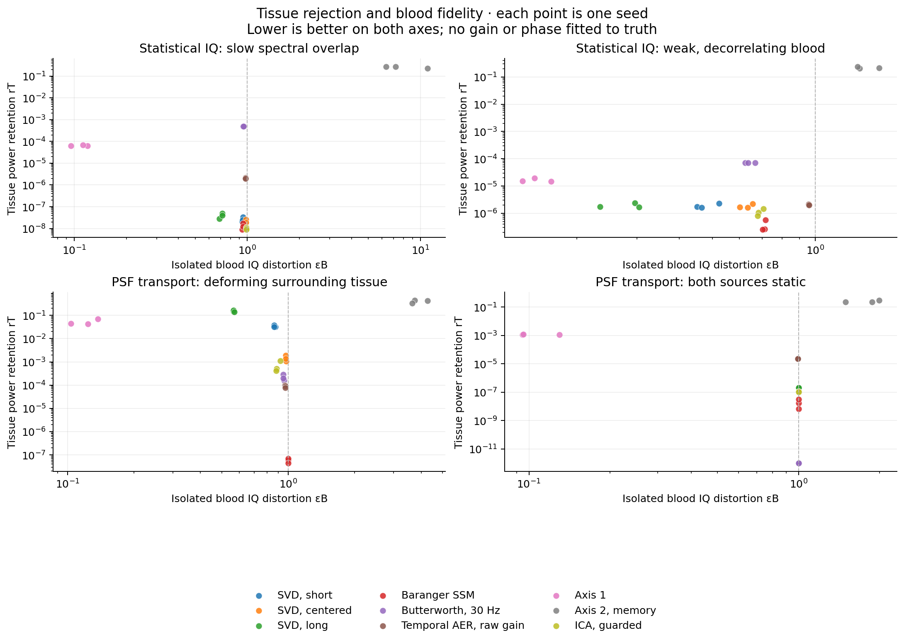

# Tissue rejection and blood-information preservation

Interpretation update, v0.3.0: the frozen-component quantities below depend on
the chosen fitted operator. Equal adaptive SVD/AER outputs can have different
left/right frozen attributions. In particular, uncentered Axis 1 without memory
equals local SVD at matching support. The numerical v0.2.0 records are retained,
but their low isolated-blood distortion does not establish a superior filter.
See [the equivalence correction and new primary endpoints](FOLLOWUP_PROTOCOL_V04.md).

The common upstream objective is to remove tissue while preserving the blood
signal's spatial, temporal, spectral and phase information. Conventional Doppler,
fUSi, ULM and WSS are downstream tests. Each application may also require its own
subsequent processing; blood physiology should remain available at this stage.

## Historical frozen-operator measurements

Write the input as \(X=B+T+N\). Fit the adaptive filter on this mixture, then
freeze its motion estimates, confidence/reset schedule, bases and component
weights. For the resulting map \(L_X\), report

\[
\epsilon_B=\frac{\|L_XB-B\|_F}{\|B\|_F},\qquad
r_T=\frac{\|L_XT\|_F^2}{\|T\|_F^2},\qquad
r_B=\frac{\|L_XB\|_F^2}{\|B\|_F^2}.
\]

The first two define a rejection/preservation tradeoff, with both minimized.
The per-case Pareto set uses finite measured values and excludes oracle arms.
It covers the declared settings only. There is no universal pooled ranking.

Additional measurements include noise power gain, residual tissue/output-blood
power, amplitude distortion, spatial power-map distortion, weak-flow and
near-wall waveform errors, pixelwise distortion quantiles and complex lag-one
covariance distortion. Normalized blood spectral shape is compared using

\[
d_{\rm PSD}=\tfrac12\sum_f|p_{L_XB}(f)-p_B(f)|,
\qquad \sum_f p(f)=1.
\]

An empty output has \(\epsilon_B=1\), zero retention, undefined spectral shape
and undefined tissue/output-blood ratio. Those undefined quantities remain
explicit; they do not become successful zero scores. Frozen component closure
is normalized by input mixture energy and checked separately.

No gain, phase rotation or registration is fitted to blood truth. Strict IQ
error is sensitive to calibration: a constant phase rotation preserves power,
spectrum and lag-one Doppler but changes raw IQ error. Companion metrics make
this distinction visible. AER's changed amplitude calibration is retained in
the results. Any allowed calibration should be declared from independent data.

## Centering and motion replay

For centered covariance memory, the frozen transform must subtract each
component's own linear pooled mean. For component \(C\), replay

\[
m_k=\rho m_{k-1}+(1-\rho)q_k,\qquad
s_k^C=\rho s_{k-1}^C+(1-\rho)q_k\bar C_k,
\qquad C_k^c=C_k-s_k^C/m_k.
\]

The mixture-fitted \(q_k\), resets, shifts and phase estimates are reused.
Subtracting the mixture mean from every isolated component would break
linearity. Low-confidence SVD fallback packets have their own frozen operator.
Boundary losses remain in the score. Axes 1–2 and ICA now expose this replay;
view-based SVD and STAP use the actual uncompounded component views.

## Oracles and nonlinear methods

The default oracle loss is blood-IQ MSE. A preservation-constrained alternative
minimizes \(r_T\) subject to a declared \(\epsilon_B\) limit. The study uses 0.25
and 0.50 as illustrative operating points, not application acceptance criteria.
Every candidate, feasibility decision and selected setting is saved. An
infeasible search preserves its curve and reports an explicit failure status.
The exhaustive lower-cutoff grid now includes the empty-output endpoint.

RPCA is nonlinear and does not expose a fictitious frozen linear decomposition.
Its end-to-end IQ error is accompanied by refitted counterfactual injection:

\[
D_\alpha=\frac{F(T+N+\alpha B)-F(T+N)}{\alpha},
\qquad \alpha\in\{0.1,1\}.
\]

This measures an incremental response, not an additive attribution of \(F(X)\).
Each background/injected fit retains its convergence diagnostics.

## Historical v0.2.0 Axes 1–2 study

[Configuration](../configs/separation_fidelity.json): 30 cases, 39 settings,
three seeds (17, 29, 43). Five statistical-IQ conditions cover slow spectral
overlap, acceleration, a tissue texture jump, weak/decorrelating blood and
opposed flow. Five PSF-transport conditions cover stationary surrounding tissue,
bulk motion, deformation, opposed flow and two static sources. All settings were
fixed before the first execution; no classifier was fitted on this case bank.

The added PSF model advects fixed reflectivities through a parabolic field and
renders their positions with a Gaussian complex PSF. A padded finite reservoir
avoids wrapping and phase resets. Surrounding tissue translates/deforms;
finite PSF width mixes wall and lumen echoes. This is a 2-D baseband model,
without RF propagation, 3-D RBC physics or fluid-structure coupling. Prescribed
fluid velocity and finite-speckle Doppler estimates are different quantities.

Methods include the literature controls, centering, full/partial temporal and
spatial AER, covariance memory, rigid registration, phase-compensation ablations,
a fixed 0.02-rad/frame phase-error control, ICA and RPCA. Every filter infers its
motion ROI from IQ; the simulation's flow mask is evaluation-only.

ICA uses centered data by default and records stopping change, whitening error,
circularity and source fourth cumulants. Its default nonconvergence policy is
an explicitly recorded local-SVD fallback. Separate retained-output 300/1500
iteration controls diagnose the solver. Convergence alone does not establish
source identification. Axis 2 records the whitening eigenvalue condition and
the largest singular value of its reconstruction operator: an oblique map can
amplify perturbations when its source basis is poorly conditioned.

Run with:

```bash
btbench separation-study --config configs/separation_fidelity.json --output runs/my_separation
python examples/plot_fidelity.py runs/my_separation/results.json docs/figures/my_fidelity
```

See [executed records](../runs/separation_fidelity_v03/SUMMARY.md) and
[validation](VALIDATION.md). Pooled medians are descriptive; case-level curves,
source distortion, failures and solver diagnostics determine interpretation.


## Executed findings and limits

All 1,170 settings/cases returned outputs. The following illustrative values
are medians across the three declared seeds within one condition:

| Condition / method | Blood distortion | Tissue retention | Residual tissue/output-blood power | End-to-end blood IQ error |
|---|---:|---:|---:|---:|
| Slow overlap / short SVD | 0.941 | 2.45e-8 | 0.00237 | 0.952 |
| Slow overlap / Axis 1 | 0.112 | 6.33e-5 | 0.672 | 0.836 |
| Both sources static / Axis 1 | 0.0954 | 0.00113 | 1.001 | 1.008 |

Low tissue retention relative to a very strong input clutter field can still
leave tissue comparable to the output blood. Component energies also have
coherent cross terms: cancellation can conceal individually retained blood.
The static control therefore requires the residual tissue/blood ratio and
end-to-end error alongside the preservation/rejection coordinates. Axis 1's
waveform preservation in this bank does not establish complete separation.

Axis 2 can strongly amplify components; its observed operator gains reach about
64–66. ICA's centered 300/1500-iteration convergence is 19/712 and 22/712 fits.
Those findings motivate conditioning/identification work before any superiority
claim. See the complete condition records and [verification](VALIDATION.md).



Every plotted condition includes all three seeds. Zero distortion is displayed
at 1e-6; tissue retention below 1e-12 is displayed at that floor. The full archive
retains actual values. The figure is descriptive and includes a failure control.
RPCA is evaluated through its separately labeled nonlinear responses.
