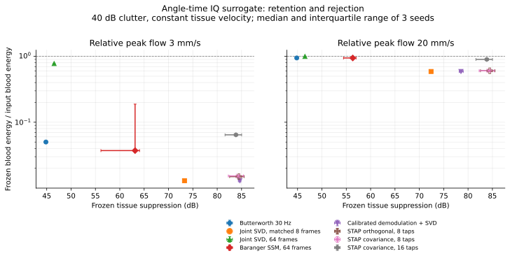
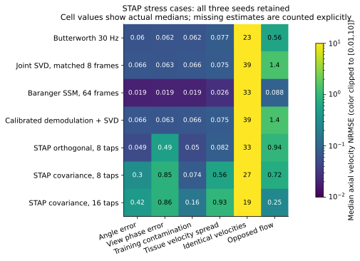
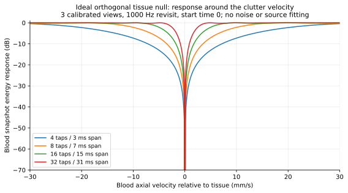

# First Axis 3 benchmark: local angle-time STAP

This is an executable, frozen-parameter study of **uncompounded angular IQ**.
The statistical forward model supplies explicit phase, geometry, source
components and flow truth. It is a first algorithmic study; RF propagation,
aperture calibration, acoustic scattering and experimental WSS are not validated.

```bash
btbench stap-study --config configs/stap_first_study.json --output runs/my_stap
btbench literature-study --config configs/svd_literature.json --output runs/my_svd_study
```

Both commands reject an existing nonempty output directory. They save their
configuration before execution. Results retain every case, failed method,
calibration estimate, oracle candidate and detector constraint rejection.

## Geometry and operators

The snapshot stacks L slow-time samples from M views. For a velocity v=(v_z,v_x),

\[
s_{\ell m}(v)=g_m\exp\!\left[
 i\epsilon\frac{2\pi f_0}{c}
 (n_m^{\rm Tx}+n_m^{\rm Rx})^T v
 \left(t_0+\frac{\ell}{\mathrm{PRF}}+\delta_m\right)\right].
\]

Angles are measured from the axial z direction. Epsilon is the explicitly
supplied IQ phase sign. PRF is the **per-view revisit rate**; delta_m accounts
for sequential transmissions. The first experiment uses three Tx angles
(-15,0,15 degrees), normal receive direction, 1000 Hz revisit rate, 5 MHz
center frequency, 1540 m/s sound speed, and known nominal complex view gains.
It does not identify a receive element index with a transmit angle.

An implementation correction uses the absolute snapshot origin t_0 for every
window. Independent zero-time resets across views corrupt the clutter manifold
when view Doppler frequencies differ. This is checked with moving tissue,
nonzero transverse velocity, complex gains, sequential offsets and both IQ signs.

For a tissue steering matrix S, the orthogonal residual operator is

\[
P_\perp=I-SS^\dagger.
\]

For training snapshots outside a spatial guard and inside an independently
specified tissue ROI, use

\[
R_\eta=\frac1K\sum_{q\in\Omega_T\setminus\mathrm{guard}} y_qy_q^H
 +\eta\frac{\operatorname{tr}(R)}{LM}I,
\qquad
P_R=I-S(S^HR_\eta^{-1}S)^\dagger S^HR_\eta^{-1}.
\]

P_R removes the supplied tissue manifold. It has no distortionless constraint
for an arbitrary blood component. Blood attenuation or amplification must
therefore be measured. Too few training pixels cause an explicit orthogonal
fallback. Sample counts, snapshot dimension and fits with fewer than twice
that dimension are recorded; diagonal loading does not create independent data.

`local_stap_views` preserves the view dimension. Frozen operators are fitted
once to each mixture and applied unchanged to the known blood, tissue and noise
components. Their sum must reproduce the mixture output. The legacy `local_stap`
API returns the coherent view mean; this study uses the preserved views.

## Calibration and information controls

An independent 48-frame tissue calibration acquisition supplies a Doppler-based
estimate of tissue velocity. It uses an annotated outer wall/tissue band and
known acquisition geometry. The prescribed test velocity and isolated test
components are never passed to a data-only filter. The calibration is additional
information. A **calibration-demodulated joint-SVD control receives that same
packet** so its benefit can be separated from the adaptive STAP operator.

Each comparison retains all three input views:

- Unfiltered IQ and a fixed 30 Hz Butterworth high-pass.
- Per-view and joint view/spatial SVD, with matched 8-frame, 4-frame-hop support.
- Joint SVD and Baranger SSM with longer 64-frame support, reported explicitly.
- Calibration-demodulated joint SVD on the matched short support.
- Orthogonal STAP and loaded covariance STAP on that support.
- A 16-tap covariance arm and a deliberately training-starved control.
- Evaluation-only oracle SVD over all **45 lower/upper bands** for the 8-mode
  short support, including the empty-output control. It optimizes blood-IQ
  error on the same case. It is not a velocity/WSS oracle or a universal bound
  over arbitrary SVD windowing/classification.

Short-window SVD and STAP use the same positive Gaussian temporal weighting and
overlap/add support. No methods recover angular information from a compounded
image. Output latency and calibration requirements are separate from CPU timing.

## LCMV detector

For a candidate blood velocity, C=[s_B,S], f=(1,0,...,0)^T and

\[
w=R_\eta^{-1}C(C^H R_\eta^{-1}C)^{-1}f.
\]

This enforces w^H s_B=1 and w^H S=0 when identifiable. The benchmark scans a
fixed 51-point axial-velocity grid at one prescribed central target. Each
snapshot score is |w^H y|^2/(w^H R_eta w), then scores are averaged. Grid
selection uses no test velocity. True target error and the grid quantization
floor are computed only afterward. Near-overlapping steering constraints,
ill-conditioned constraints and numerical response failures are rejected and
counted. The result is a velocity-bank **detector**, with no fabricated
phase-preserving IQ output or detector-derived WSS.

## Cases and measurements

The frozen file defines 42 cases:

- 24 factorial cases: two relative peak speeds (3 and 20 mm/s), two
  clutter levels (20 and 40 dB), two overlying-tissue accelerations
  (0 and 0.03 m/s^2), and three seeds.
- 18 stress cases: angular calibration error, unknown view phase error,
  contamination of the training ROI, tissue velocity spread, identical
  blood/tissue velocity with coherent blood, and opposed flow; three seeds each.

Blood is a dense correlated complex Gaussian IQ field with prescribed Doppler
phase and decorrelation. The angle envelope is shared except for phase and gain.
The fixed vessel geometry and wall velocity define a directional 2-D polynomial
WSS comparator. The noise-free isolated-blood readout is reported as an
evaluation control to expose finite-ensemble velocity bias. These assumptions
cannot establish scattering fidelity for native RBCs or robustness in vivo.

Reported outputs include raw blood-IQ error, frozen blood and tissue retention,
residual tissue/blood and noise/blood ratios, vector/axial and near-wall velocity
errors, invalid-estimate fractions, directional WSS error, power-Doppler AUC,
training fallbacks, constraint error and white-noise gain. Invalid velocity
estimates are failures; they are not removed from the evaluation mask.

`runs/stap_v02_verified` contains the verified execution. `runs/svd_literature_v02_verified` contains
24 additional statistical-IQ cases with 20 SVD/EVD/Butterworth comparison arms.
Per-condition records are authoritative. Pooled medians include deliberate
failure controls and must not be read as a universal ranking.

## Interpretation boundary

At identical steering vectors, a tissue null also nulls coherent blood.
A distortionless blood response and a null on the same vector are incompatible.
Away from exact coincidence, short snapshots can still attenuate slow blood
severely. Calibration mismatch, motion bandwidth and sample support must be
examined jointly with clutter rejection. The first study quantifies these
effects without assuming a positive STAP result.

The next experimental step needs uncompounded angular/channel IQ with verified
timing, geometry and view calibration. Full receive-aperture, near-field and
nonrigid-motion STAP require acquisition-specific forward models.

## Figures

Generate the figures with `.[plot]` installed:

```bash
python examples/plot_studies.py --stap runs/stap_v02_verified/results.json --output docs/figures
```







The response figure is an analytic snapshot calculation with exact calibration;
it is separate from the fitted-operator benchmark records.
