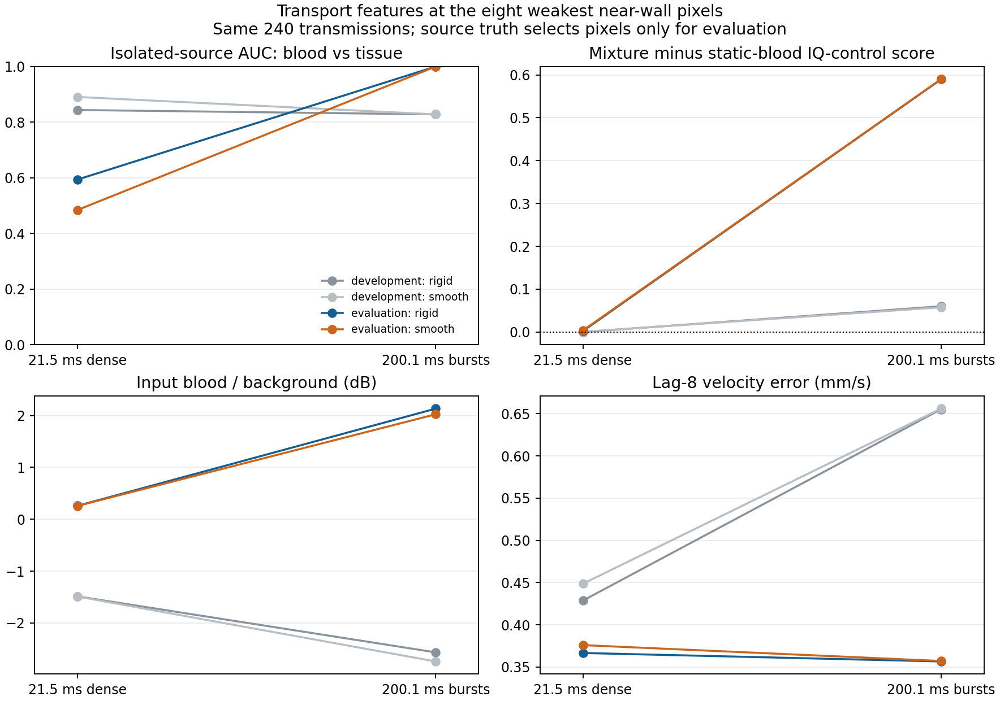

# Tissue-frame transport information test

26 October 2026. [Acquisition code](../examples/transport_lag_acquire.py),
[information scorer](../scripts/transport_lag_information.py),
[configuration](../configs/transport_lag_information_v1.json),
[freeze](../runs/transport_lag_information_v1/freeze.json),
[archive verifier](../scripts/verify_transport_lag_information.py).

## Question and protocol

Does a physically chosen transform of the same complex echoes reveal a more
useful distinction than SVD rank: tissue fixed in its material frame, blood
advected through that frame, and receiver noise uncorrelated across firings?
This is an **information diagnostic, not a new blood filter**. It examines
isolated source feature distributions and then asks whether their separation
survives in the *actual mixture*, especially at low-contrast wall pixels.

The original [receive-core source diagnostic](RECEIVE_CORE_SOURCE_PROFILE_V1.md)
showed that the weak wall is limited principally by residual tissue, not by
thermal noise. We retrospectively replay four seen 80-cycle eSDIva scenes
(3907/3919, rigid/smooth) to inspect this feature. An independently specified
acoustic acquisition then uses cloud 5003 for development and cloud 5017 for
prospective numerical evaluation, with rigid and smooth motion in each.
These are still homogeneous, linear, point-scatterer simulations, not physical
red-cell measurements. The 5003 development archive and source/configuration
hashes were frozen before scoring 5017. A documented amendment corrected
**receiver-noise fairness** before inspecting 5017 RF: the two schedules now
use an identical absolute noise scale calculated from their 24 identical
initial RF events and their first 900 samples. The initial pre-amendment
[freeze](../runs/transport_lag_information_v1/freeze_pre_noise_amendment.json)
is retained for audit.

Each matched pair uses the **same initial scatterers, three transmit angles,
80 cycles, 240 total emissions, carrier and beamformer**. Blood and tissue
RF in the first eight cycles are identical; receiver-noise draws are
independent. The dense schedule revisits at 3,700 cycles/s over about
21.53 ms. The burst schedule puts ten groups of eight 3,700-cycle/s cycles
22 ms apart, extending the observation to about 200.07 ms. Tissue motion is
defined in physical seconds (3 Hz lateral, 2 Hz axial, up to 0.30/0.06 mm),
and blood has the original tilted Poiseuille profile at 2% of Example 22's
speed. The smooth class adds modest spatial variation to tissue displacement.
The longer observation is an **acquisition change** at fixed transmission
count, not extra information obtained by software from the original 21.53 ms.

eSDIva's model excludes actual red-cell frequency dependence, vessel wall
reflection, reverberation, heterogeneous sound speed, and real scanner
electronics. Gaussian receiver noise is synthesized in independent RF events.
Both schedules generate separate blood and tissue RF. IQ source closure is
checked, and the RF report and IQ-array identities are saved in the result
archive; the large raw RF checkpoints stay outside the repository.

## Fixed representation and what uses truth

Three angles are coherently compounded. For every observed mixture frame,
we fit a **B-mode translation to the first frame** using the whole imaged
field (bounded to one pixel in each direction), warp complex IQ by that
translation, and estimate one global IQ phase from its complex correlation
with the first frame. The same transformation is applied unchanged to
isolated sources when scoring them. No known scatterer displacement, tube
mask, isolated tissue, or blood enters this registration.

For a registered IQ sequence \(I_t(p)\), define normalized complex
cross-time covariance at pixel \(p\):

\[
C_\ell(p)=
\frac{\sum_{t\in V_\ell}I_t(p)^*I_{t+\ell}(p)}
{\sqrt{\sum_{t\in V_\ell}|I_t(p)|^2
       \sum_{t\in V_\ell}|I_{t+\ell}(p)|^2}},
\qquad S(p)=|C_1(p)|-\operatorname{Re}C_{48}(p).
\]

For the short lag, \(V_1\) excludes nine between-burst gaps; the 70 remaining
pairs have the same 0.270 ms separation in both schedules. Lag 48 spans
12.973 ms in dense and 132 ms in burst mode. The intended signature is
\(S\approx0\) for aligned persistent tissue, positive \(S\) for a coherent
moving echo, and near-zero \(S\) for noise. Finite noise and tissue tracking
errors can also raise the score. No score cutoff or classifier is fit.

The **evaluator only** uses known tube geometry to mark 16 near-wall pixels
(0.75–1 vessel radius), and isolated source powers in the common first eight
cycles to select the eight with the lowest blood/tissue ratio. The paired
pixel set is identical across the two schedules. Source AUC compares eight
isolated blood scores with eight isolated tissue/noise scores; it is a
diagnostic of feature overlap and does not identify blood in a mixture.

The more relevant checks compare the *observed mixture* with (i) isolated
tissue-plus-noise and (ii) an evaluator-created **static-blood IQ control**,
formed by repeating the first blood IQ frame through time and adding the same
tissue and noise. The control receives its own observed-mixture registration.
It is a model-derived counterfactual, not a physically measured flow-off
recording. We also search a few shifts along the *known vessel direction* to
measure an optimistic spatial-transport bound. That direction/speed search
uses geometry truth **only for diagnosis** and is not a candidate filter;
maximizing over shifts can elevate noise as well as blood.

The lag-eight axial phase velocity is computed with each schedule's **actual
22 ms or 2.16 ms lag**, never by treating the burst sequence as uniformly
sampled. Error is measured against blood-only IQ from the same schedule;
nominal physical velocity is reported separately because the imaging PSF
and speckle already bias the blood-only profile.

## Results

The [retrospective archive](../runs/transport_lag_information_v1/retrospective.json),
[development archive](../runs/transport_lag_information_v1/development.json),
and [independent numerical archive](../runs/transport_lag_information_v1/evaluation.json)
preserve source hashes and individual pixel feature values. Results and
interpretation are below. AUC 0.5 is chance-level ranking for the 8-versus-8
source-score comparison; 1 means complete ranking on these few correlated
pixels. Every arrow is **dense → burst** for a single initial cloud and
motion class. The mixture score difference is dimensionless; it is **not** a
measured blood/background ratio or a filtered blood power.

| Cloud and motion | Isolated blood vs tissue AUC | Isolated blood vs noise AUC | Mixture minus static-blood score | *Input* blood/background | Median lag-8 velocity error vs blood-only IQ |
|:--|:--:|:--:|--:|--:|--:|
| 5003 development, rigid | 0.84 → 0.83 | 0.25 → 0.89 | +0.000 → +0.060 | −1.5 → −2.6 dB | 0.43 → 0.66 mm/s |
| 5003 development, smooth | 0.89 → 0.83 | 0.25 → 0.89 | +0.001 → +0.058 | −1.5 → −2.7 dB | 0.45 → 0.66 mm/s |
| **5017 independent, rigid** | **0.59 → 1.00** | **0.50 → 1.00** | **+0.002 → +0.590** | **+0.3 → +2.1 dB** | **0.37 → 0.36 mm/s** |
| **5017 independent, smooth** | **0.48 → 1.00** | **0.50 → 1.00** | **+0.004 → +0.590** | **+0.3 → +2.0 dB** | **0.38 → 0.36 mm/s** |

The longer span exposes a strong blood feature in the independent cloud, but
**not consistently across clouds**. Its isolated-source blood/tissue AUC goes
to 1.00 on both 5017 scenes, while it remains 0.83 on both 5003 scenes.
The latter are somewhat weaker input blood/background scenes and their
mixture-versus-static score difference is about **ten times smaller** than
5017's. Motion class hardly changes these paired results because the
prescribed smooth deformation is modest; rigid and smooth rows from the same
cloud are correlated evidence, not four independent replicates.

Across all four newly acquired scenes, the longer span improves isolated
blood/noise ranking. It does **not** establish a simple source-blind filter:
the mixture-minus-background score at the eight weak wall pixels is only
about +0.007–0.008 in 5003's burst scenes, compared with +0.45–0.46 in 5017's.
The static-blood counterfactual gives +0.058–0.060 versus +0.590. A fixed
threshold on the feature would be especially sensitive to these different
clouds, and the score alone does not tell us which part of a complex mixture
to remove while preserving the remainder.

The **input** blood/background numbers in the table reflect different
speckle realizations over the two observation spans, even though emission
count and initial cloud are matched; they are not a contrast gain from a
filter. Near-wall velocity error versus blood-only IQ improves negligibly in
5017 (~0.37 to ~0.36 mm/s), and worsens in 5003 (~0.44 to ~0.66 mm/s).
The 5017 blood-only weak-wall median itself changes from roughly
0.2–0.3 mm/s in the dense sequence to 1.1 mm/s in the bursts, illustrating
why the **blood-only imaging reference and nominal geometric flow** must be
kept separate. We have not demonstrated a reliably recovered velocity profile.

The evaluator-only directional shift search is also not a safe automatic
criterion. On 5003's burst scenes, maximizing correlation over six possible
speeds raises the *noise* correlation magnitude by about 0.063 on average,
more than the blood correlation's ~0.025; this is finite-sample search bias.
On 5017 blood's gain is larger (~0.17), again emphasizing cloud dependence.

The four previously seen phase-11 scenes had their own faster prescribed
tissue motion and are **not pooled** with the new matched-duration experiment.
They produce weak-wall blood/tissue source AUCs 0.88–1.00 on 21.6 ms IQ,
yet mixture-versus-static-blood score differences of only +0.026–0.082.
This reinforces the distinction between source separability and a useful
mixture measurement; it does not validate the new long-span schedule in an
independent physical acquisition.

## Decision and next discriminating observation

This experiment supports a limited physics hypothesis: sampling slow flow
over a longer wall-clock time at the same emission count can expose its
coherent change relative to aligned tissue, and source-only blood/noise
separation can improve markedly. The candidate \(S\) is **not yet a robust
clutter filter**. At the weak wall, blood/tissue overlap and flow evidence
vary substantially between two scatterer clouds; a simple directional
correlation maximum can favor noise; and velocity preservation has not been
shown. No ranking in this report substitutes for source-separated blood
retention, remaining tissue power, blood/background ratio *after filtering*,
or the recovered local velocity profile.

Before spending effort on a fitted threshold or a large nonlinear model, the
most discriminating physical test is a paired **noncontrast flow-on/off**
acquisition with native IQ, recorded tissue motion and a fixed transmission
budget. Include low signal near-wall locations, out-of-plane motion and
reverberation, and compare several temporal spans. If the flow-on/off
mixture signatures overlap under those conditions, the feature map cannot
supply the desired simple source-blind separator; a genuinely different
measurement of blood material or mechanical response would then be needed.
